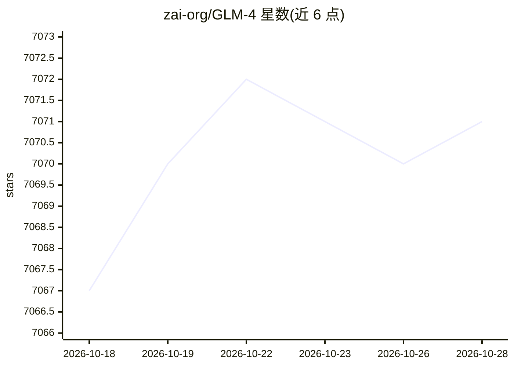

# zai-org/GLM-4

⭐ 7,071 · Python · Apache-2.0 · 推送 2026-08-05 · [GitHub](https://github.com/zai-org/GLM-4) · 组织维护 · 中文 README

**智谱开源的 GLM-4 系列多语言多模态对话模型**

Z.ai（智谱）发布的开源大模型系列仓库，涵盖 GLM-4-9B/32B-0414 对话模型、GLM-Z1 推理模型与 GLM-Z1-Rumination 深度思考模型（可调用搜索工具），权重托管于 Hugging Face、ModelScope 等平台。模型实现已合并进 vLLM、transformers、llama.cpp；README 提供 LoRA 微调脚本示例，并说明 YaRN 长上下文扩展配置。原生 32K 上下文，最长可扩展至 128K。

## 筛选速览

| 维度 | 判定 | 备注 |
|---|---|---|
| AI 角色 | `ai-native` | 本体是模型或模型工具 |
| 许可风险 | `permissive` | Apache-2.0 |
| 部署形态 | `library` | 以包/库形式分发 |
| 模型依赖 | local-ok | 支持本地模型 |
| 硬件要求 | — | 无带数字的原话,不猜 |
| 安装摩擦 | `low` | 无编译、无系统依赖或容器化 |
| 成熟度 | — | 结构信号不足 |

## 能力要点

- GLM-4-32B-Base-0414 在 15T 数据上预训练，含推理型合成数据
- GLM-Z1-Rumination 深度思考中可使用搜索工具处理开放式复杂任务
- 模型实现已合并 vLLM/transformers/llama.cpp，支持本地部署
- 提供 LoRA 微调脚本与 SwanLab 训练可视化

## 适用场景

- 本地部署开源对话/推理大模型
- 在代码生成、函数调用、agent 任务中使用
- 用官方脚本做 LoRA 微调适配自有数据

## 场景标签

`多模态` `微调` `代码生成` · 领域:编码与开发

## 证据(README 行号)

> L18: The GLM family welcomes new members, the **GLM-4-32B-0414** series models, featuring 32 billion parameters. Its per
> L78: |GLM-4-9B-0414|Chat|32K -> 128K|🤗 Huggingface 🤖 ModelScope 🧩 Modelers 🟣 WiseModel|

## 星数曲线

2026-10-18 7,067 → 2026-10-28 7,071（+4）

---
*卡片 v1 · prompt 1.4 · 生成 2026-10-20 · 置信度 mid · 依据 README sha `304601c611b8` · [字段定义](../../DATASET.md)*
