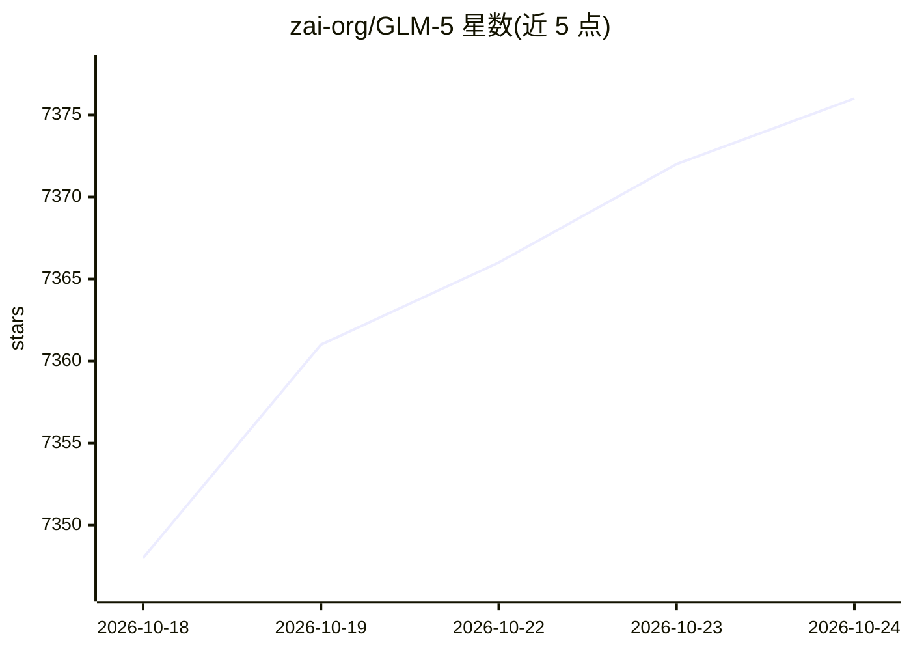

# zai-org/GLM-5

⭐ 7,383 · Apache-2.0 · 推送 2026-10-15 · [GitHub](https://github.com/zai-org/GLM-5) · [官网](https://z.ai/blog/glm-5.2) · 组织维护 · 中文 README

**面向 agentic 工程与长程任务的开源大模型系列（GLM-5.x）**

智谱（Z.ai / GLM 团队）发布的开源权重大模型系列，包含 GLM-5（744B-A40B，BF16/FP8）、GLM-5.1/5.2（744B，1M 上下文）与 GLM-5.3 / GLM-5.3-Flash（320B-A18B，稀疏+线性混合注意力、mHC）。通过 Hugging Face 与 ModelScope 提供权重下载，支持 SGLang、vLLM、Transformers、KTransformers、Unsloth 本地部署，以及 Ascend NPU 平台的 vLLM-Ascend、xLLM、SGLang。支持 reasoning_effort 控制思考预算，可用 Slime 与 ms-swift 微调（SFT/PPO/GRPO）。

## 筛选速览

| 维度 | 判定 | 备注 |
|---|---|---|
| AI 角色 | `ai-native` | 本体是模型或模型工具 |
| 许可风险 | `permissive` | Apache-2.0 |
| 部署形态 | `None` |  |
| 模型依赖 | local-ok | 支持本地模型 |
| 硬件要求 | — | 无带数字的原话,不猜 |
| 安装摩擦 | `low` | 无编译、无系统依赖或容器化 |
| 成熟度 | — | 结构信号不足 |

## 能力要点

- 系列含 744B-A40B 旗舰与 320B-A18B Flash 版本，GLM-5.2 提供稳定 1M token 上下文
- GLM-5.3-Flash 采用稀疏+线性混合注意力与 mHC，降低长上下文服务成本
- 支持 SGLang/vLLM/Transformers/KTransformers/Unsloth 及 Ascend NPU 部署
- 支持 reasoning_effort 三档思考预算控制与 Slime/ms-swift 微调

## 适用场景

- 下载权重在本地用 vLLM 或 SGLang 部署做编码与 agentic 任务
- 长上下文（1M token）代码库理解与仓库级任务
- 通过 Z.ai API 平台调用 GLM-5.3 系列服务

## 场景标签

 · 领域:大语言模型/模型权重

## 证据(README 行号)

> L72: |GLM-5.3|🤗 Hugging Face 🤖 ModelScope|744B-A40B|FP8|
> L83: ## Serve GLM-5 Series Models Locally

## 星数曲线

2026-10-18 7,348 → 2026-10-24 7,376（+28）

---
*卡片 v1 · prompt 1.4 · 生成 2026-10-20 · 置信度 high · 依据 README sha `6fd40332d215` · [字段定义](../../DATASET.md)*
