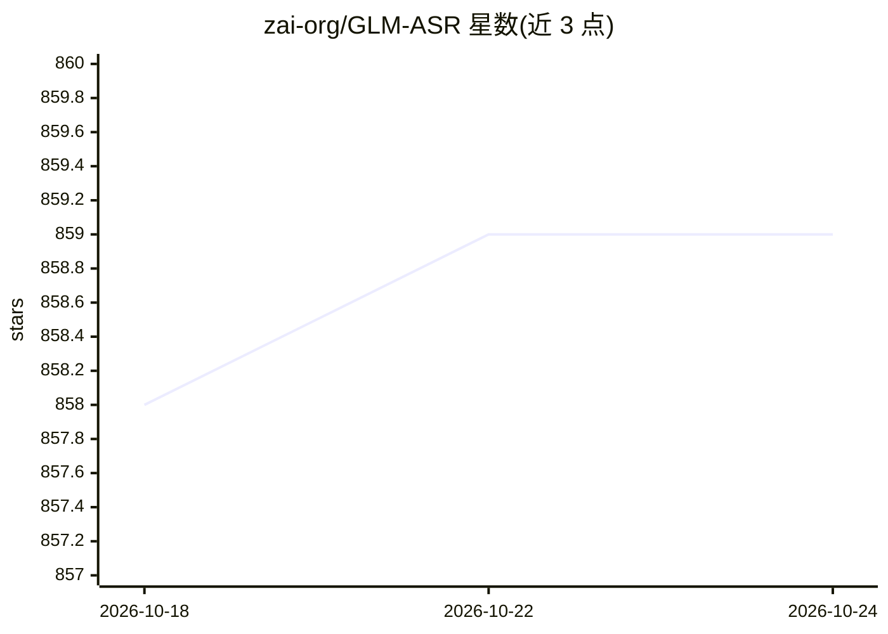

# zai-org/GLM-ASR

⭐ 859 · Python · Apache-2.0 · 推送 2026-03-06 · [GitHub](https://github.com/zai-org/GLM-ASR) · [官网](https://autoglm.zhipuai.cn/autotyper) · 组织维护 · 中文 README

**面向终端用户的 1.5B 参数开源语音识别模型**

GLM-ASR-Nano-2512 是 zai-org 发布的 1.5B 参数开源语音识别模型，支持 17 种语言（WER ≤ 20%），针对粤语等方言及低音量语音场景做了训练优化。模型权重发布于 Hugging Face 与 ModelScope，提供 transformers 与 SGLang 两种推理路径：transformers 5.0.0 需从源码安装，SGLang 需使用最新开发版 Docker 镜像并通过 OpenAI 兼容接口请求。附中英文测试音频与示例代码。

## 筛选速览

| 维度 | 判定 | 备注 |
|---|---|---|
| AI 角色 | `ai-native` | 本体是模型或模型工具 |
| 许可风险 | `permissive` | Apache-2.0 |
| 部署形态 | `self-host` | docker 或自建部署 |
| 模型依赖 | — | README 未给出锁定关系 |
| 硬件要求 | — | 无带数字的原话,不猜 |
| 安装摩擦 | `low` | 无编译、无系统依赖或容器化 |
| 成熟度 | — | 结构信号不足 |

## 能力要点

- 1.5B 参数语音识别模型，支持 17 种语言
- 针对粤语等方言与低音量（安静语音）场景优化
- 提供 transformers 与 SGLang 两种推理路径
- 权重托管于 Hugging Face 与 ModelScope

## 适用场景

- 我需要转写含方言或低音量的中英文音频
- 部署一个可通过 OpenAI 兼容接口调用的 ASR 服务
- 在会议等含噪声与重叠语音的场景下做语音转文字

## 场景标签

 · 领域:语音识别/多模态模型

## 证据(README 行号)

> L11: **GLM-ASR-Nano-2512** is a robust, open-source speech recognition model with **1.5B parameters**. Designed for
> L21:  Specifically trained for **"Whisper/Quiet Speech"** scenarios. It captures and accurately transcribes extremely

## 星数曲线

2026-10-18 858 → 2026-10-24 859（+1）

---
*卡片 v1 · prompt 1.4 · 生成 2026-10-21 · 置信度 mid · 依据 README sha `e367baf3cbc5` · [字段定义](../../DATASET.md)*
