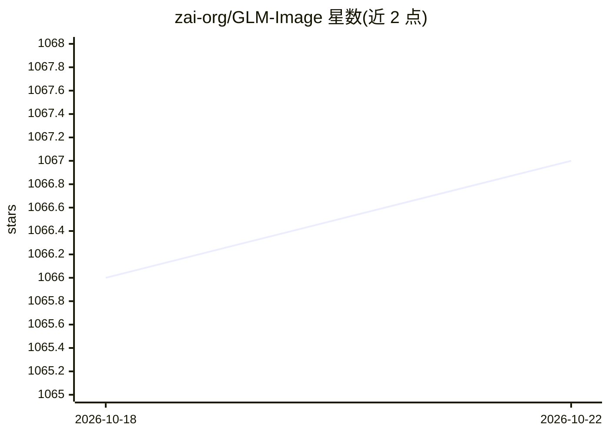

# zai-org/GLM-Image

⭐ 1,067 · Python · Apache-2.0 · 推送 2026-03-20 · [GitHub](https://github.com/zai-org/GLM-Image) · [官网](https://z.ai/blog/glm-image) · 组织维护 · 中文 README

**自回归+扩散混合架构的开源文生图/图生图模型（9B+7B）**

智谱（zai-org）开源的图像生成模型，采用混合架构：9B 参数自回归生成器（初始化自 GLM-4-9B-0414，先生成约 256 token 压缩编码再扩展至 1K–4K token）加 7B 单流 DiT 扩散解码器（含 Glyph Encoder 文本模块），支持单一模型内文生图与图生图（编辑、风格迁移、身份保持、多主体一致性），后训练使用解耦强化学习（GRPO）。运行依赖 transformers/diffusers 或 SGLang，需 80GB 以上显存单卡或多卡，目标分辨率须被 32 整除。

## 筛选速览

| 维度 | 判定 | 备注 |
|---|---|---|
| AI 角色 | `ai-native` | 本体是模型或模型工具 |
| 许可风险 | `permissive` | Apache-2.0 |
| 部署形态 | `library` | 以包/库形式分发 |
| 模型依赖 | — | README 未给出锁定关系 |
| 硬件要求 | — | 无带数字的原话,不猜 |
| 安装摩擦 | `low` | 无编译、无系统依赖或容器化 |
| 成熟度 | `idea` | |

## 能力要点

- 9B 自回归生成器 + 7B DiT 扩散解码器（含 Glyph Encoder 文本模块）
- 单模型同时支持文生图与多种图生图任务
- GRPO 解耦强化学习后训练：AR 模块低频反馈 + 解码器高频反馈
- 提供 transformers/diffusers 与 SGLang 两种推理管线

## 适用场景

- 生成含密集文字与知识性内容的图像
- 图像编辑、风格迁移、身份保持与多主体一致性生成
- 本地部署并通过 SGLang OpenAI 兼容接口提供图像生成服务

## 场景标签

 · 领域:图像生成/生成式模型

## 证据(README 行号)

> L13: GLM-Image is an image generation model adopts a hybrid autoregressive + diffusion decoder architecture. In general 
> L29: GLM-Image supports both text-to-image and image-to-image generation within a single model.
> L114: + Because the inference optimizations for this architecture are currently limited, the runtime cost is still relat

## 星数曲线

2026-10-18 1,066 → 2026-10-22 1,067（+1）

---
*卡片 v1 · prompt 1.4 · 生成 2026-10-21 · 置信度 mid · 依据 README sha `f2d676b0c1d7` · [字段定义](../../DATASET.md)*
