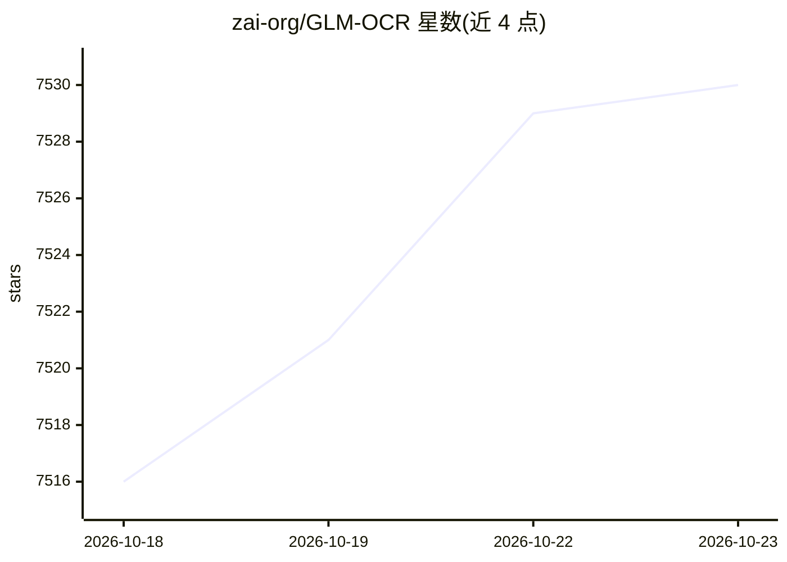

# zai-org/GLM-OCR

⭐ 7,530 · Python · Apache-2.0 · 推送 2026-10-14 · [GitHub](https://github.com/zai-org/GLM-OCR) · 组织维护 · 中文 README

**面向复杂文档理解的多模态 OCR 模型及配套 SDK**

智谱（zai-org）开源的 0.9B 参数多模态 OCR 模型：GLM-V 编码器-解码器架构，CogViT 视觉编码器 + GLM-0.5B 语言解码器，采用 PP-DocLayout-V3 的两阶段版面分析与并行识别流水线，输出 Markdown 与 JSON 版面结果，覆盖公式、表格、印章、代码类文档等场景。提供 glmocr SDK（pip 安装、CLI/Python/Flask 服务），支持智谱 MaaS 云 API、vLLM/SGLang 自托管、Ollama/MLX 及 GPU 服务器+无 GPU 客户端等多种部署方式。代码 Apache 2.0 许可。

## 筛选速览

| 维度 | 判定 | 备注 |
|---|---|---|
| AI 角色 | `ai-native` | 本体是模型或模型工具 |
| 许可风险 | `permissive` | Apache-2.0 |
| 部署形态 | `self-host` | docker 或自建部署 |
| 模型依赖 | local-ok | 支持本地模型 |
| 硬件要求 | — | 无带数字的原话,不猜 |
| 安装摩擦 | `low` | 无编译、无系统依赖或容器化 |
| 成熟度 | — | 结构信号不足 |

## 能力要点

- 0.9B 参数多模态 OCR，OmniDocBench V1.5 得分 94.62
- 两阶段流水线：PP-DocLayout-V3 版面分析 + 并行区域识别
- 支持 vLLM/SGLang/Ollama/MLX 部署及 MaaS 云 API
- SDK 含 CLI、Python API、Flask 服务与可组合模块化架构

## 适用场景

- 批量解析复杂版面文档为 Markdown/JSON
- 高并发的文档识别服务部署
- 在 Apple Silicon 上本地运行 OCR 推理

## 场景标签

`OCR` `文档解析` · 领域:知识与检索

## 证据(README 行号)

> L13: GLM-OCR is a multimodal OCR model for complex document understanding, built on the GLM-V encoder–decoder architectu
> L21: - **Efficient Inference**: With only 0.9B parameters, GLM-OCR supports deployment via vLLM, SGLang, and Ollama, sig

## 星数曲线

2026-10-18 7,516 → 2026-10-23 7,530（+14）

---
*卡片 v1 · prompt 1.4 · 生成 2026-10-20 · 置信度 mid · 依据 README sha `c51e8e063e9a` · [字段定义](../../DATASET.md)*
