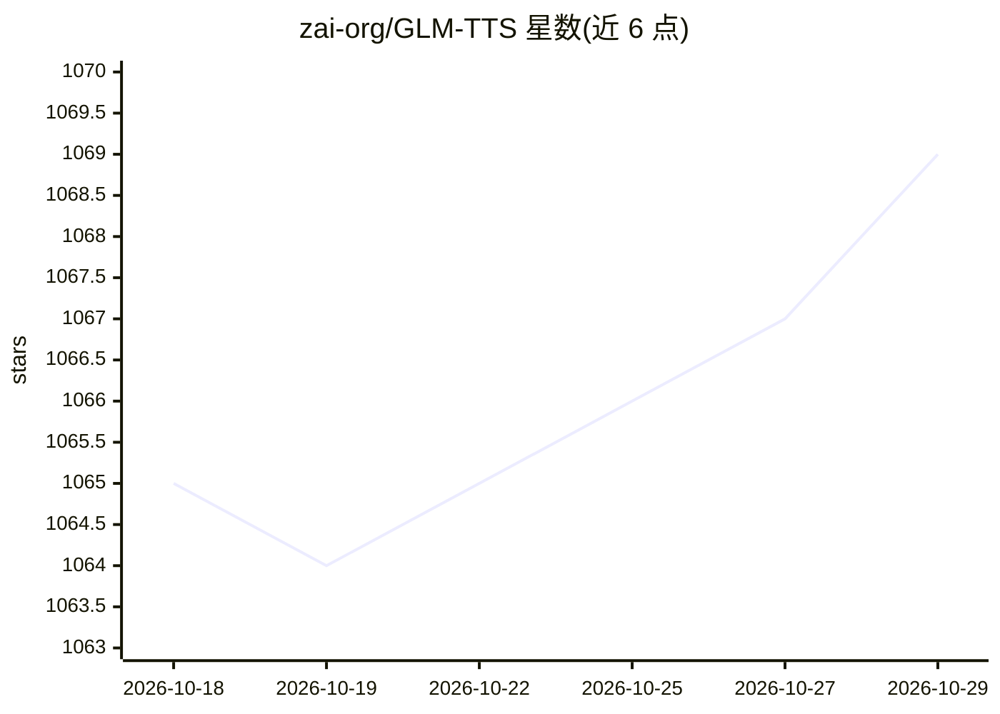

# zai-org/GLM-TTS

⭐ 1,069 · Python · Apache-2.0 · 推送 2026-04-10 · [GitHub](https://github.com/zai-org/GLM-TTS) · [官网](https://audio.z.ai) · 组织维护 · 中文 README

**零样本语音克隆与情感表达的开源 TTS 系统**

基于大语言模型的两阶段文本转语音系统：LLM 生成语音 token 序列，Flow Matching 模型转换为 mel 谱，再经 vocoder 生成波形。支持 3-10 秒音频零样本克隆、流式推理、音素级发音控制与中英混输，并采用多奖励强化学习（GRPO）优化情感表达。提供推理脚本与预训练权重（HuggingFace/ModelScope），支持 GPU 与华为 NPU（CANN 镜像），含命令行与 Gradio 网页推理入口。主要面向中文场景，来自 zai-org（智谱）团队。

## 筛选速览

| 维度 | 判定 | 备注 |
|---|---|---|
| AI 角色 | `ai-native` | 本体是模型或模型工具 |
| 许可风险 | `permissive` | Apache-2.0 |
| 部署形态 | `None` |  |
| 模型依赖 | — | README 未给出锁定关系 |
| 硬件要求 | — | 无带数字的原话,不猜 |
| 安装摩擦 | `low` | 无编译、无系统依赖或容器化 |
| 成熟度 | — | 结构信号不足 |

## 能力要点

- 3-10 秒提示音频实现零样本语音克隆
- 多奖励强化学习（GRPO）优化情感表达，CER 从 1.03 降至 0.89
- Phoneme-in 机制支持混合音素+文本的多音字定向发音控制
- 流式推理与 GPU/华为 NPU 双后端支持

## 适用场景

- 为应用生成可克隆任意说话人音色的中文语音
- 教育测评、有声书等需要精确发音控制的场景
- 交互式应用的实时流式语音合成

## 场景标签

`语音合成` · 领域:内容生成

## 证据(README 行号)

> L14: GLM-TTS is a high-quality text-to-speech (TTS) synthesis system based on large language models, supporting zero-sho
> L25: - **Zero-shot Voice Cloning**: Clone any speaker's voice with just 3-10 seconds of prompt audio

## 星数曲线

2026-10-18 1,065 → 2026-10-29 1,069（+4）

---
*卡片 v1 · prompt 1.4 · 生成 2026-10-21 · 置信度 high · 依据 README sha `8e1bc2965e82` · [字段定义](../../DATASET.md)*
