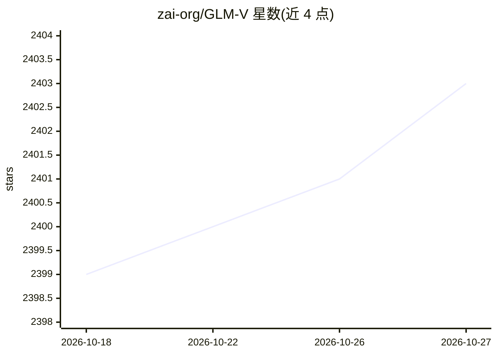

# zai-org/GLM-V

⭐ 2,403 · Python · Apache-2.0 · 推送 2026-10-23 · [GitHub](https://github.com/zai-org/GLM-V) · 组织维护 · 中文 README

**智谱开源的 GLM-V 系列视觉语言模型（图像/视频理解与推理）**

zai-org（智谱）开源的视觉语言模型仓库，收录 GLM-4.6V（106B/Flash 9B）、GLM-4.5V、GLM-4.1V-9B-Thinking/Base 等模型权重（Hugging Face/ModelScope/GGUF）。能力覆盖图像与视频理解、长文档解析、GUI Agent 操作、视觉定位（grounding）、前端页面复刻，GLM-4.6V 支持原生多模态 Function Calling 与 128K 上下文。本地部署支持 SGLang/vLLM/Transformers 及昇腾 NPU；微调经 LLaMA-Factory，另有桌面助手示例与 Midscene.js 集成。仓库公告自 2026/09/02 起不再维护，相关问题转往 GLM-5 仓库。

## 筛选速览

| 维度 | 判定 | 备注 |
|---|---|---|
| AI 角色 | `ai-native` | 本体是模型或模型工具 |
| 许可风险 | `permissive` | Apache-2.0 |
| 部署形态 | `None` |  |
| 模型依赖 | local-ok | 支持本地模型 |
| 硬件要求 | — | 无带数字的原话,不猜 |
| 安装摩擦 | `low` | 无编译、无系统依赖或容器化 |
| 成熟度 | — | 结构信号不足 |

## 能力要点

- 多规格模型权重开源：106B、9B Flash、FP8 量化与 GGUF 格式
- 图像/视频/长文档理解、GUI Agent、视觉定位（bounding box 输出）
- GLM-4.6V 原生多模态 Function Calling 与 128K 上下文
- 支持 SGLang/vLLM/Transformers 本地部署与昇腾 NPU 推理

## 适用场景

- 本地部署多模态模型做图像视频理解与文档解析
- 构建 GUI 自动化 agent 或桌面视觉助手
- 基于 Base 模型做视觉语言模型研究微调

## 场景标签

`多模态` `GUI 自动化` `文档解析` · 领域:效率与自动化

## 证据(README 行号)

> L23: **This open-source repository contains our `GLM-4.6V`, `GLM-4.5V` and `GLM-4.1V` series models.** For performance a
> L78: GLM-4.5V / GLM-4.6V / GLM-4.1V equips precise grounding capabilities. Given a prompt that requests the location of 
> L110: - vLLM (v0.25.0+) — see recipes

## 星数曲线

2026-10-18 2,399 → 2026-10-27 2,403（+4）

---
*卡片 v1 · prompt 1.4 · 生成 2026-10-21 · 置信度 high · 依据 README sha `95fa1f692981` · [字段定义](../../DATASET.md)*
