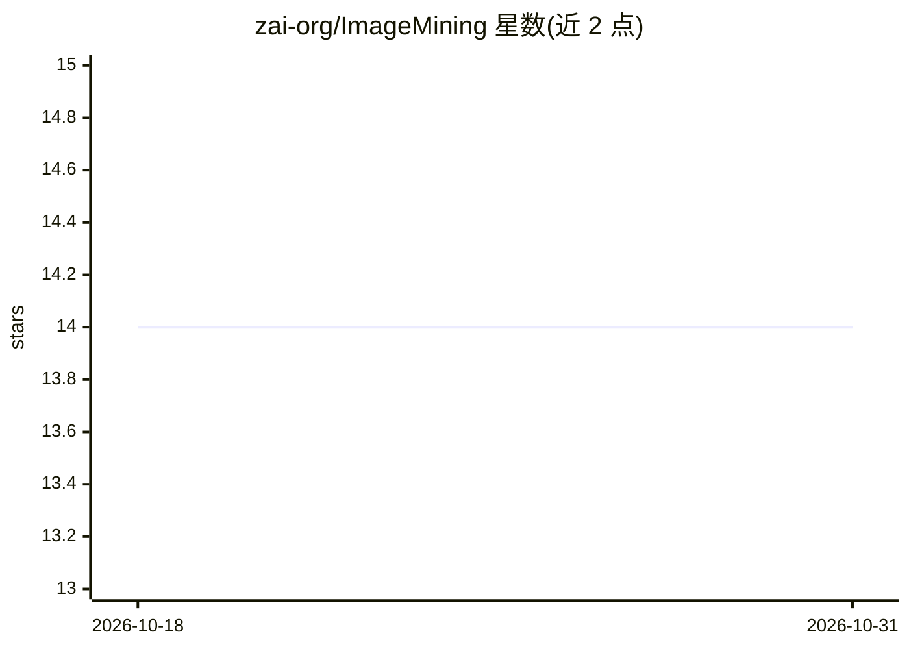

# zai-org/ImageMining

⭐ 14 · 推送 2026-05-16 · [GitHub](https://github.com/zai-org/ImageMining) · 组织维护 · 中文 README

**多模态 agent 视觉深度搜索评测基准数据集（217 题）**

由 zai-org 发布的视觉中心基准数据集，用于评测多模态 agent 将高密度视觉理解与自主深度搜索结合的能力。共 217 个测试用例，覆盖 7 个领域、23 个子类、5 种推理类型；题目要求模型通过局部裁剪、细节放大、跨源交叉验证等多步工具调用主动挖掘视觉信息。每条含中英双语问答与人工校验的推理链，标注是否需在搜索前/中用图。通过 Hugging Face datasets 加载，图片需从清华云盘另行下载，许可限研究用途。

## 筛选速览

| 维度 | 判定 | 备注 |
|---|---|---|
| AI 角色 | `ai-knowledge` | 知识聚合/清单类 |
| 许可风险 | `none` | — |
| 部署形态 | `None` |  |
| 模型依赖 | — | README 未给出锁定关系 |
| 硬件要求 | — | 无带数字的原话,不猜 |
| 安装摩擦 | `low` | 无编译、无系统依赖或容器化 |
| 成熟度 | — | 结构信号不足 |

## 能力要点

- 217 用例，7 领域 23 子类，5 种推理类型标注
- 每条含中英双语问答与人工校验推理链
- 标注 need_image_before_search / need_image_during_search 字段
- 通过 Hugging Face datasets 加载

## 适用场景

- 评测多模态 agent 的视觉深度搜索能力
- 研究以图像为锚点的多步工具调用推理
- 构建含推理链标注的视觉问答评测集

## 场景标签

`模型评测` `多模态` · 领域:评测与运维

## 证据(README 行号)

> L11: ImageMining is a benchmark designed to evaluate multimodal agents on their ability to integrate high-density visual
> L21: |Total test cases|217|

## 星数曲线

2026-10-18 14 → 2026-10-31 14（+0）

---
*卡片 v1 · prompt 1.4 · 生成 2026-10-31 · 置信度 high · 依据 README sha `86ec93d45268` · [字段定义](../../DATASET.md)*
