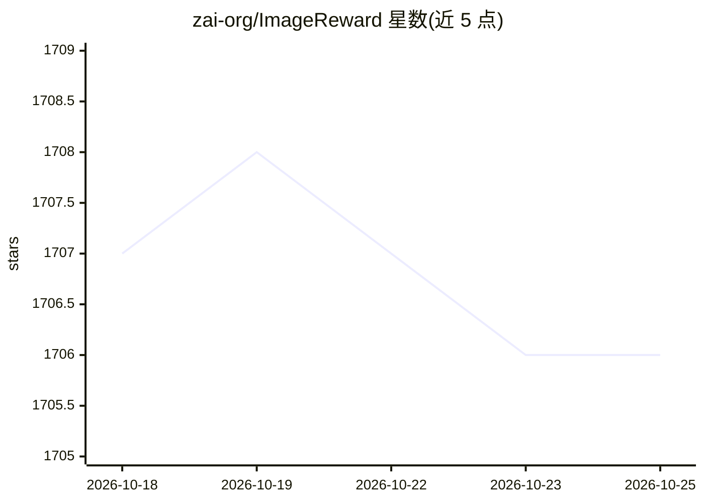

# zai-org/ImageReward

⭐ 1,706 · Python · Apache-2.0 · 推送 2025-10-29 · [GitHub](https://github.com/zai-org/ImageReward) · 组织维护 · 中文 README

**文生图人类偏好奖励模型，为生成图像打分并支持 ReFL 微调**

NeurIPS 2023 论文的官方实现：基于 137k 专家比较对训练的文本到图像人类偏好奖励模型（ImageReward-v1.0），输入 prompt 与图像即可输出偏好分数；另提供 ReFL（Reward Feedback Learning）方法，用该奖励模型直接微调 Stable Diffusion 等文生图扩散模型。以 Python 包 image-reward（pip 安装）发布，附带训练代码、基准复现脚本，以及集成进 Stable Diffusion Web UI 的自定义脚本（打分、低分过滤）。

## 筛选速览

| 维度 | 判定 | 备注 |
|---|---|---|
| AI 角色 | `ai-native` | 本体是模型或模型工具 |
| 许可风险 | `permissive` | Apache-2.0 |
| 部署形态 | `library` | 以包/库形式分发 |
| 模型依赖 | — | README 未给出锁定关系 |
| 硬件要求 | — | 无带数字的原话,不猜 |
| 安装摩擦 | `medium` | 含编译或系统依赖之一 |
| 成熟度 | — | 结构信号不足 |

## 能力要点

- ImageReward-v1.0：3 行代码对 prompt-图像对输出人类偏好分数
- ReFL 奖励反馈学习直接优化文生图扩散模型
- 提供 SD Web UI 自定义脚本：图像打分与低分自动过滤
- 附完整训练代码与论文 Table 1/3 基准复现脚本

## 适用场景

- 给文生图模型输出的图像按人类偏好打分排序
- 用 ReFL 微调 Stable Diffusion 提升生成偏好
- 在 SD Web UI 中自动过滤低分生成图像
- 复现论文基准实验或训练自己的偏好奖励模型

## 场景标签

`微调` `强化学习` `模型评测` · 领域:评测与运维

## 证据(README 行号)

> L11: ImageReward is the first general-purpose text-to-image human preference RM, which is trained on in total **137k pai
> L13: Additionally, we introduce Reward Feedback Learning (ReFL) for direct optimizing a text-to-image diffusion model us
> L26: rewards = model.score("<prompt>", ["<img1_obj_or_path>", "<img2_obj_or_path>", ...])

## 星数曲线

2026-10-18 1,707 → 2026-10-25 1,706（-1）

---
*卡片 v1 · prompt 1.4 · 生成 2026-10-21 · 置信度 high · 依据 README sha `46591d61e4f4` · [字段定义](../../DATASET.md)*
