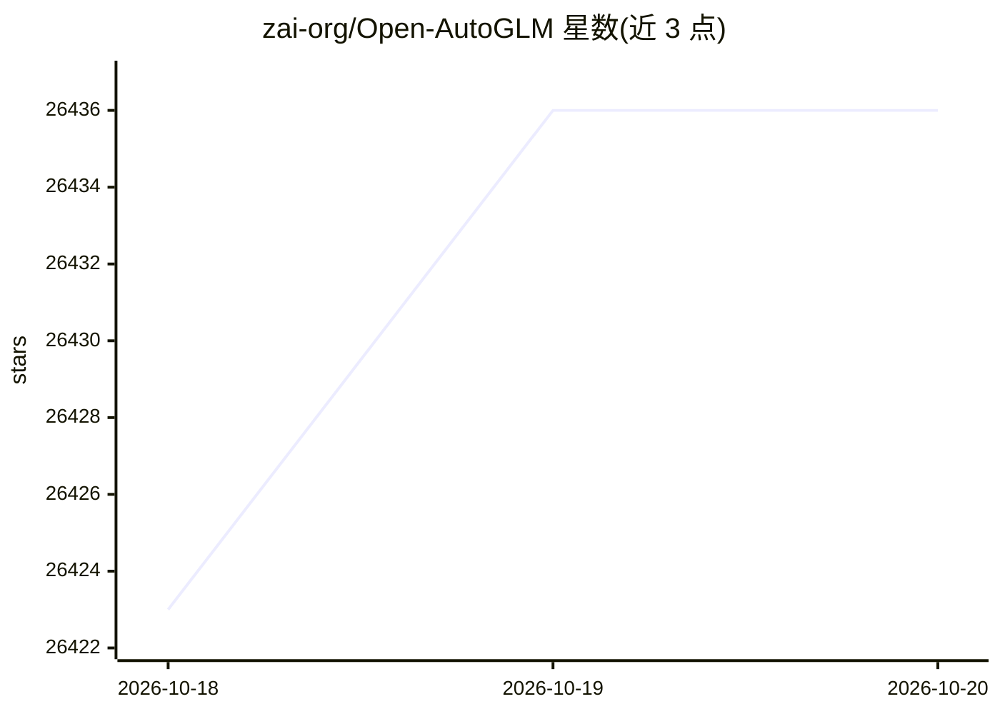

# zai-org/Open-AutoGLM

⭐ 26,436 · Python · Apache-2.0 · 推送 2026-03-06 · [GitHub](https://github.com/zai-org/Open-AutoGLM) · [官网](https://autoglm.z.ai/blog) · 组织维护 · 中文 README

**基于视觉语言模型控制手机完成任务的 Phone Agent 框架**

由智谱开源的 Phone Agent 框架，通过 ADB/HDC 控制安卓或鸿蒙设备，以视觉语言模型感知屏幕截图、规划并执行点击、滑动、输入等操作，响应用户的自然语言指令。支持命令行与 Python API 两种调用方式，内置敏感操作确认与人工接管机制，提供远程 WiFi 调试。模型可用智谱 BigModel、ModelScope 等第三方 API，或通过 vLLM/SGLang 自行部署（本地部署建议 24GB+ 显存 GPU）。面向研究与学习用途。

## 筛选速览

| 维度 | 判定 | 备注 |
|---|---|---|
| AI 角色 | `ai-native` | 本体是模型或模型工具 |
| 许可风险 | `permissive` | Apache-2.0 |
| 部署形态 | `self-host` | docker 或自建部署 |
| 模型依赖 | local-ok | 支持本地模型 |
| 硬件要求 | — | 无带数字的原话,不猜 |
| 安装摩擦 | `low` | 无编译、无系统依赖或容器化 |
| 成熟度 | — | 结构信号不足 |

## 动量与使用信号

- 维护:`declining` — 距上次 push 226.0 天,年发版 0,10 位贡献者
- 涨星:近 1 天 **+14**(自 20261016 起算)
- 安装:pypi 包 `nvidia-cudnn-cu12` 月下载 14,590,798
- 平台:WINDOWS / MACOS / LINUX / ANDROID / IOS · 协议:—

## 能力要点

- 通过 ADB/HDC 控制安卓与鸿蒙设备，以截图+视觉模型循环执行操作
- 支持 50+ 款 Android 中文应用与 60+ 款鸿蒙原生应用
- 提供 vLLM/SGLang 本地部署与智谱 BigModel、ModelScope API 两种模型接入方式
- 内置敏感操作确认、人工接管回调与远程 ADB/HDC 调试

## 适用场景

- 用自然语言让 AI 代为操作手机完成搜索、下单等任务
- 研究与开发手机端 GUI Agent 的二次开发
- 通过 Midscene.js 实现 iOS/Android 上的自动化流程

## 场景标签

`GUI 自动化` `Agent 框架` · 领域:Agent 开发

## 证据(README 行号)

> L24: Phone Agent 是一个基于 AutoGLM 构建的手机端智能助理框架，它能够以多模态方式理解手机屏幕内容，并通过自动化操作帮助用户完成任务。系统通过
> L610: - **原理**：截图 → 视觉模型理解界面 → 输出点击坐标 → ADB 执行操作 → 循环
> L642:  - 需要 NVIDIA GPU(建议 24GB+ 显存)

## 星数曲线

2026-10-18 26,423 → 2026-10-20 26,436（+13）

---
*卡片 v1 · prompt 1.4 · 生成 2026-10-18 · 置信度 mid · 依据 README sha `4fde4bf97301` · [字段定义](../../DATASET.md)*
