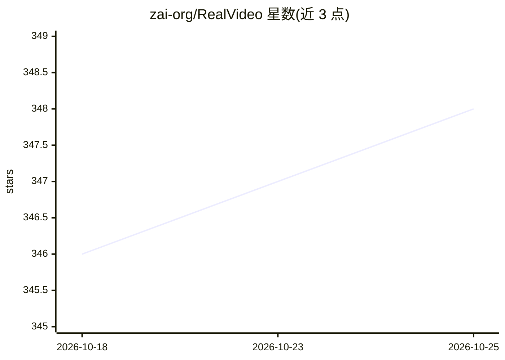

# zai-org/RealVideo

⭐ 348 · Python · Apache-2.0 · 推送 2025-12-15 · [GitHub](https://github.com/zai-org/RealVideo) · [官网](https://z.ai/blog/realvideo) · 组织维护 · 中文 README

**实时流式对话视频系统：文本输入生成语音与口型同步视频**

基于 WebSocket 的视频通话系统：接收文本消息，调用 GLM-4.5-AirX 与 GLM-TTS 生成语音回复，再通过自回归扩散生成对应口型同步的视频帧，实时返回给浏览器端。支持上传任意图像设定形象、上传 3 秒以上音频做语音克隆。运行需 ZAI API key 与本地下载的 Wan2.2-S2V-14B 模型，至少 2 张 80GB GPU（如 H100/H200），一块跑 VAE、其余并行跑 DiT；官方给出 DiT 单块生成耗时参考表，500ms 内可实现流畅实时生成。

## 筛选速览

| 维度 | 判定 | 备注 |
|---|---|---|
| AI 角色 | `ai-native` | 本体是模型或模型工具 |
| 许可风险 | `permissive` | Apache-2.0 |
| 部署形态 | `library` | 以包/库形式分发 |
| 模型依赖 | — | README 未给出锁定关系 |
| 硬件要求 | — | 无带数字的原话,不猜 |
| 安装摩擦 | `low` | 无编译、无系统依赖或容器化 |
| 成熟度 | — | 结构信号不足 |

## 能力要点

- 文本输入经 GLM-4.5-AirX/GLM-TTS 生成语音，自回归扩散生成口型同步视频
- 支持上传图像设定形象与 3 秒以上音频语音克隆
- WebSocket 实时双向通信，浏览器端（WebSocket + Web Audio API）访问
- DiT 多 GPU 并行与编译加速，官方给出单块生成耗时基准表

## 适用场景

- 搭建可实时对话的数字人/虚拟形象视频通话应用
- 通过文本消息驱动带克隆音色的视频应答
- 研究自回归扩散的实时视频生成部署方案

## 场景标签

`语音合成` `视频生成` · 领域:内容生成

## 证据(README 行号)

> L3: RealVideo is a WebSocket-based video calling system that supports text input. It leverages **GLM-4.5-AirX** and
> L4: **GLM-TTS** models to generate audio responses and utilizes autoregressive diffusion to generate corresponding
> L19: - **AI Voice Response**: Integrates GLM-4.5-AirX and GLM-TTS models to generate voice responses.

## 星数曲线

2026-10-18 346 → 2026-10-25 348（+2）

---
*卡片 v1 · prompt 1.4 · 生成 2026-10-21 · 置信度 mid · 依据 README sha `0d16e1dc3f68` · [字段定义](../../DATASET.md)*
