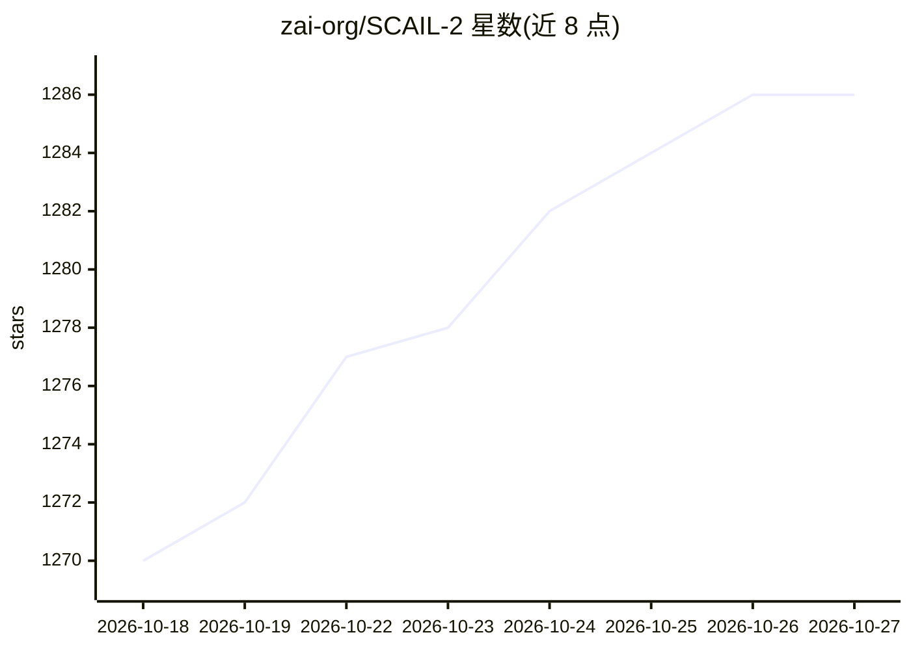

# zai-org/SCAIL-2

⭐ 1,286 · Python · Apache-2.0 · 推送 2026-08-24 · [GitHub](https://github.com/zai-org/SCAIL-2) · 组织维护 · 中文 README

**角色动画视频生成模型官方实现：端到端动作驱动与角色替换**

SCAIL-2 论文的官方推理与训练代码：一个开源角色动画模型，支持端到端动作驱动视频生成、姿态驱动动画与角色替换，通过 Unified Motion Transfer Interface（2 类掩码通道与专用 RoPE）绕开中间姿态表示，具备跨身份替换、动物驱动等能力，另有 Bias-Aware DPO LoRA 与 ComfyUI 集成。流程为：克隆仓库并 pip 安装依赖、下载 HuggingFace 权重、用 SCAIL-Pose 子模块做输入预处理，再以 generate.py 单卡推理；可选 Gemini 提示词增强器。Python 需 3.10–3.12。

## 筛选速览

| 维度 | 判定 | 备注 |
|---|---|---|
| AI 角色 | `ai-native` | 本体是模型或模型工具 |
| 许可风险 | `permissive` | Apache-2.0 |
| 部署形态 | `library` | 以包/库形式分发 |
| 模型依赖 | — | README 未给出锁定关系 |
| 硬件要求 | — | 无带数字的原话,不猜 |
| 安装摩擦 | `low` | 无编译、无系统依赖或容器化 |
| 成熟度 | — | 结构信号不足 |

## 能力要点

- 端到端动作驱动、姿态驱动与角色替换三种模式
- 掩码通道实现零样本多参考生成与多角色动画
- 提供 Bias-Aware DPO LoRA 与 ComfyUI 集成、训练代码（sat-scail2 分支）
- 可选 Gemini 提示词增强器将简短替换指令转为正向提示词

## 适用场景

- 用参考图+驱动视频生成角色动画视频
- 将视频中角色替换为指定参考角色
- 多参考图补充背面/特写等单图未覆盖信息

## 场景标签

`视频生成` · 领域:内容生成

## 证据(README 行号)

> L16: This repository contains the official implementation code of SCAIL-2: Unifying Controlled Character Animation with 
> L38: To bypass intermediate pose representation, we utilize several off-the-shelf models, including SCAIL-Preview, Wan-A

## 星数曲线

2026-10-18 1,270 → 2026-10-27 1,286（+16）

---
*卡片 v1 · prompt 1.4 · 生成 2026-10-21 · 置信度 mid · 依据 README sha `ab1b84084bd2` · [字段定义](../../DATASET.md)*
