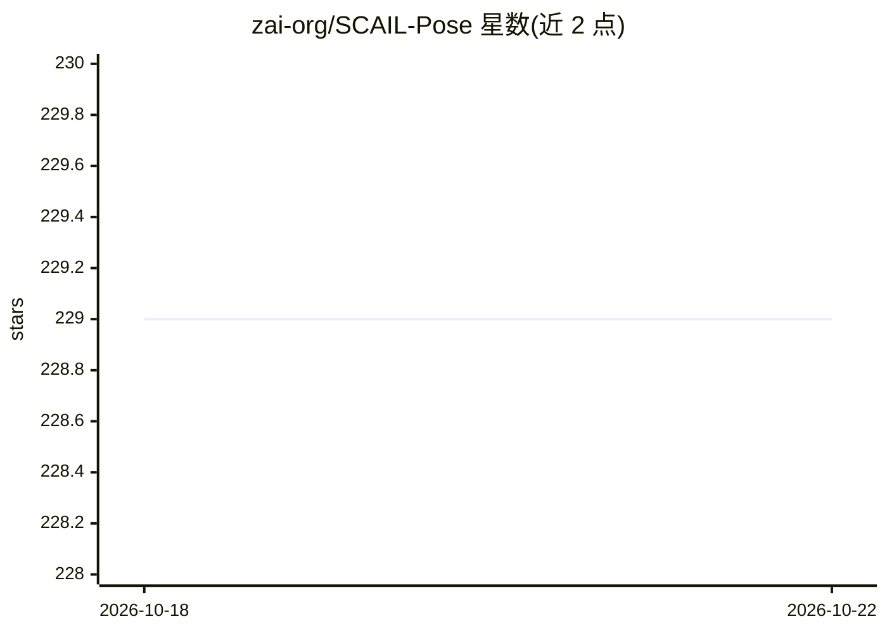

# zai-org/SCAIL-Pose

⭐ 229 · Python · Apache-2.0 · 推送 2026-06-11 · [GitHub](https://github.com/zai-org/SCAIL-Pose) · 组织维护 · 中文 README

**SCAIL 角色动画框架的驱动视频姿态提取与渲染代码**

zai-org/SCAIL 系列的官方周边仓库，为主仓库提供驱动视频的前处理代码：用 NLFPose（torchscript）、DWPose/YOLOX（onnx）提取姿态，SCAIL-2 路径额外用 SAM3 提取参考图与驱动序列的掩码，支持端到端动画模式与角色替换模式两种入口。需先克隆主仓库，在其目录下使用；环境基于 mmpose（建议 Python>=3.10），权重需手动或脚本下载，SAM3 权重 gated 于 HuggingFace 需申请访问。

## 筛选速览

| 维度 | 判定 | 备注 |
|---|---|---|
| AI 角色 | `ai-native` | 本体是模型或模型工具 |
| 许可风险 | `permissive` | Apache-2.0 |
| 部署形态 | `library` | 以包/库形式分发 |
| 模型依赖 | — | README 未给出锁定关系 |
| 硬件要求 | — | 无带数字的原话,不猜 |
| 安装摩擦 | `low` | 无编译、无系统依赖或容器化 |
| 成熟度 | — | 结构信号不足 |

## 能力要点

- NLFPose/DWPose/YOLOX 姿态提取管线，3D 骨架表征支持多人交互
- SCAIL-2 端到端模式用 SAM3 掩码替代中间骨架，支持动物等非外视角驱动源
- Animation 与 Replacement 两个入口脚本，输出可直接喂入主仓库生成动画

## 适用场景

- 为 SCAIL/SCAIL-2 准备驱动视频的姿态与掩码数据
- 用整段驱动视频或姿态驱动生成角色动画的前处理
- 多人视频中替换单一角色的预处理

## 场景标签

 · 领域:计算机视觉/角色动画

## 证据(README 行号)

> L7: This repository contains the code to process driving videos for **SCAIL**, a series of frameworks towards Studio-Gra
> L25: Our latest **SCAIL-2** is an end-to-end framework to bypass the pose estimation to obtain more reliable and express

## 星数曲线

2026-10-18 229 → 2026-10-22 229（+0）

---
*卡片 v1 · prompt 1.4 · 生成 2026-10-22 · 置信度 high · 依据 README sha `7b1eafd07067` · [字段定义](../../DATASET.md)*
