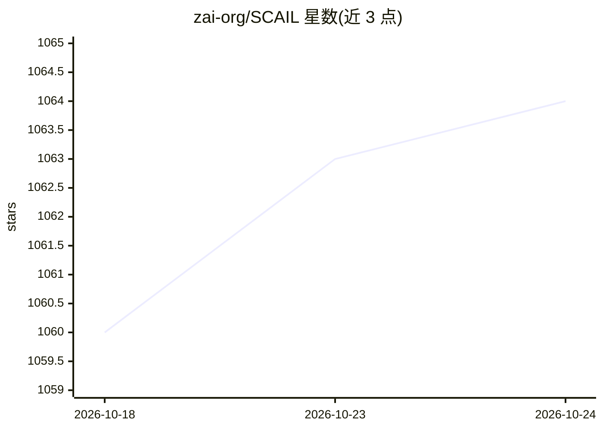

# zai-org/SCAIL

⭐ 1,064 · Python · Apache-2.0 · 推送 2026-05-06 · [GitHub](https://github.com/zai-org/SCAIL) · 组织维护 · 中文 README

**14B DiT 角色动画视频生成模型：参考图+驱动视频生成动画**

CVPR 2026 Findings 论文 SCAIL 的官方推理实现：基于 14B DiT 的角色动画生成模型，通过 3D 一致性姿态表示与上下文学习（In-Context Learning）注入姿态条件，输入参考图像与驱动视频（经 scail_pose 模块提取并渲染姿态），生成长提示词描述的角色动画视频。模型权重发布于 HuggingFace 与 ModelScope，支持 SAT 与 Wan 官方框架推理，社区另有 ComfyUI 适配与 GGUF 版本。需 Python 3.10-3.12 环境，当前为 SCAIL-Preview（512p、5s），SCAIL-2 尚未发布。

## 筛选速览

| 维度 | 判定 | 备注 |
|---|---|---|
| AI 角色 | `ai-native` | 本体是模型或模型工具 |
| 许可风险 | `permissive` | Apache-2.0 |
| 部署形态 | `library` | 以包/库形式分发 |
| 模型依赖 | — | README 未给出锁定关系 |
| 硬件要求 | — | 无带数字的原话,不猜 |
| 安装摩擦 | `low` | 无编译、无系统依赖或容器化 |
| 成熟度 | `idea` | |

## 能力要点

- 3D 一致性姿态表示 + 上下文学习的姿态条件注入
- SCAIL-Preview 14B 权重（512p、5s）发布于 HuggingFace/ModelScope
- 提供 SAT 与 Wan 官方框架两条推理路径，姿态提取经 scail_pose 子模块
- 社区存在 ComfyUI、WanGP 低显存、GGUF 等适配

## 适用场景

- 用参考图和驱动视频生成角色动画视频
- 驱动手绘、动漫、多角色乃至四足角色的动作迁移
- 在 ComfyUI 等 workflow 中做 video2video 角色动画

## 场景标签

`视频生成` · 领域:内容生成

## 证据(README 行号)

> L3: This repository contains the official implementation code of our paper accepted by *CVPR 2026 Findings Track*: **SCA
> L43: * 2025.12.08: 🔥 We release the inference code of SCAIL on SAT.

## 星数曲线

2026-10-18 1,060 → 2026-10-24 1,064（+4）

---
*卡片 v1 · prompt 1.4 · 生成 2026-10-21 · 置信度 high · 依据 README sha `711eb5585199` · [字段定义](../../DATASET.md)*
