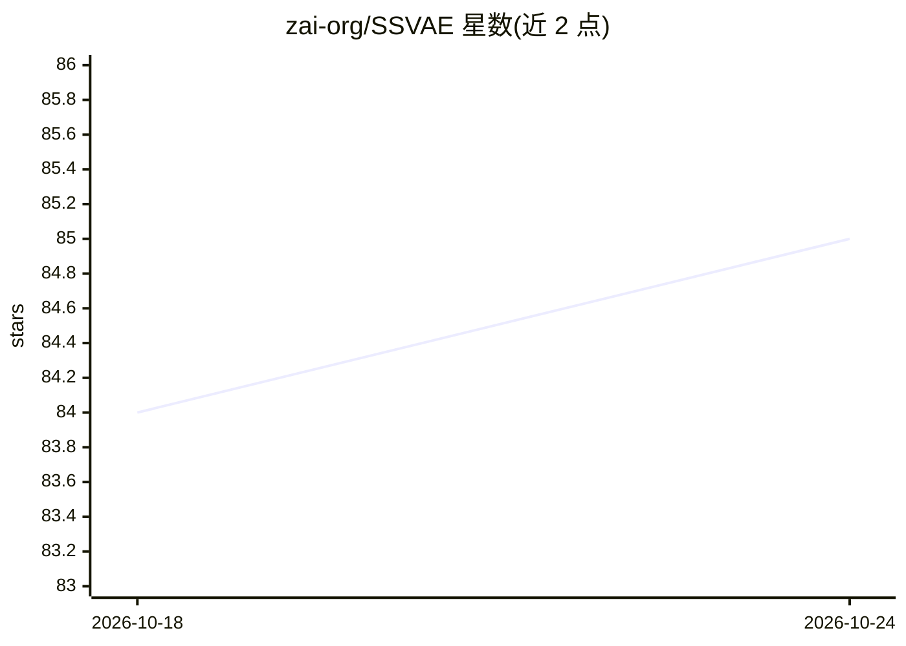

# zai-org/SSVAE

⭐ 85 · Python · Apache-2.0 · 推送 2025-12-25 · [GitHub](https://github.com/zai-org/SSVAE) · 组织维护 · 中文 README

**视频 VAE 论文官方实现：优化潜空间频谱提升扩散训练效率**

论文《Delving into Latent Spectral Biasing of Video VAEs for Superior Diffusability》的官方实现，面向视频生成研究者。SSVAE 通过两项机制优化 VAE 潜空间的频谱性质：局部相关性正则（LCR）诱导低频偏置，潜空间掩码重建（LMR）促进少模态偏置。训练采用两阶段流程（作者使用 32 张 H100 进行第一阶段），数据需按 WebDataset 格式组织；提供预训练模型（Hugging Face/魔搭）与推理脚本，可将 SSVAE 目录替换进 CogVideo 等文生视频框架做生成训练。注意与新版 torchvision 的 pytorchvideo 兼容性需手动修补。

## 筛选速览

| 维度 | 判定 | 备注 |
|---|---|---|
| AI 角色 | `ai-native` | 本体是模型或模型工具 |
| 许可风险 | `permissive` | Apache-2.0 |
| 部署形态 | `None` |  |
| 模型依赖 | — | README 未给出锁定关系 |
| 硬件要求 | — | 无带数字的原话,不猜 |
| 安装摩擦 | `low` | 无编译、无系统依赖或容器化 |
| 成熟度 | — | 结构信号不足 |

## 能力要点

- LCR 正则与 LMR 掩码重建两项机制改变潜空间频谱分布
- 两阶段训练：256p 全量训练后冻结编码器微调解码器（512p）
- 提供预训练模型与重构推理脚本
- 可替换 CogVideo 的 VAE 目录接入文生视频训练框架

## 适用场景

- 复现论文中的视频 VAE 训练与频谱分析实验
- 用预训练 SSVAE 做视频重构或接入扩散模型潜空间
- 研究生成训练中 VAE 潜空间性质对收敛的影响

## 场景标签

 · 领域:视频生成/生成模型研究

## 证据(README 行号)

> L8: This repository contains the official implementation of the paper **"Delving into Latent Spectral Biasing of Video V
> L14: to improved diffusability. Motivated by this, we introduce **SSVAE (Spectral-Structured VAE)**, which optimizes the

## 星数曲线

2026-10-18 84 → 2026-10-24 85（+1）

---
*卡片 v1 · prompt 1.4 · 生成 2026-10-24 · 置信度 high · 依据 README sha `f5c3f064a9c4` · [字段定义](../../DATASET.md)*
