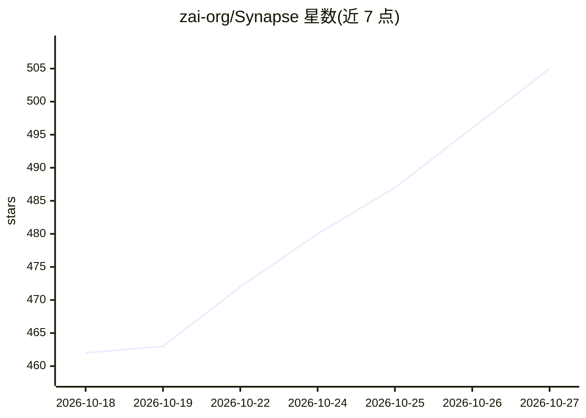

# zai-org/Synapse

⭐ 505 · TypeScript · Apache-2.0 · 推送 2026-07-31 · [GitHub](https://github.com/zai-org/Synapse) · [官网](https://synapse-zai-org.vercel.app/) · 组织维护 · 中文 README

**自托管的共享 AI 队友工作台：对话即协作边界**

自托管 AI 工作区，以对话为运行时边界组织人类与 AI 队友协作：原生 actor、经桥接的远程 agent（Claude Code、Codex CLI 通过反向 MCP 以拉取方式接入）与外部 IM 身份（飞书/微信/钉钉/QQ/Telegram/WhatsApp 等 8 种）同处一线程。插件、技能、设备、沙箱、记忆空间均通过单一可撤销的 workspace_resource_grants 授权账本管理；支持配对设备上的文件系统/命令行/浏览器等 MCP 工具、会话级沙箱（本地进程/Docker/E2B 兼容 VM）、定时与 webhook 唤醒、跨对话记忆（词法+嵌入检索）。仍处早期设计阶段，schema 与运行时契约可能变化，不保证旧数据向后兼容。本地部署依赖 Node.js 22 与 Docker Compose。

## 筛选速览

| 维度 | 判定 | 备注 |
|---|---|---|
| AI 角色 | `ai-ecosystem` | LLM/agent 周边工具 |
| 许可风险 | `permissive` | Apache-2.0 |
| 部署形态 | `self-host` | docker 或自建部署 |
| 模型依赖 | — | README 未给出锁定关系 |
| 硬件要求 | — | 无带数字的原话,不猜 |
| 安装摩擦 | `low` | 无编译、无系统依赖或容器化 |
| 成熟度 | `idea` | |

## 能力要点

- 对话即运行时边界：成员/原生 actor/桥接远程 agent/外部 IM 身份共享同一线程
- 统一 workspace_resource_grants 授权账本，显式、可撤销、敏感调用支持会话内一次性审批卡片
- 设备配对暴露文件系统/命令行/浏览器/计算机使用为 MCP 工具，出站连接、签名信封
- 会话级沙箱（本地进程/Docker/CubeSandbox），文件以内容寻址快照持久化

## 适用场景

- 把笔记本上的编码 agent 桥接进团队对话协作
- 在飞书/微信/Telegram 等现有 IM 中与 AI 队友对话并受统一权限治理
- 让 actor 在配对的真实设备上经授权执行文件与命令操作

## 场景标签

`Agent 框架` · 领域:Agent 开发

## 证据(README 行号)

> L26: Synapse is a conversation-centric runtime for digital teammates.
> L28: Most AI products treat chat as a thin interface over an isolated bot. Synapse treats the conversation itself as the
> L44: A coding agent running on your laptop can join the team as a first-class participant. The machine-side daemon (`pac

## 星数曲线

2026-10-18 462 → 2026-10-27 505（+43）

---
*卡片 v1 · prompt 1.4 · 生成 2026-10-21 · 置信度 high · 依据 README sha `111cadf23316` · [字段定义](../../DATASET.md)*
