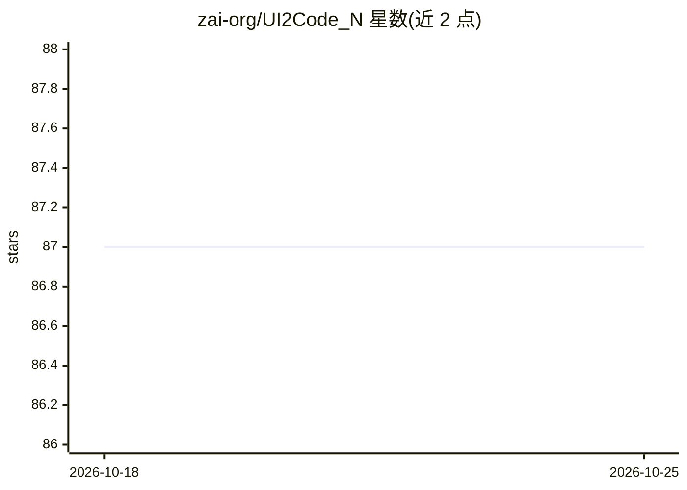

# zai-org/UI2Code_N

⭐ 87 · Python · 推送 2026-05-02 · [GitHub](https://github.com/zai-org/UI2Code_N) · 组织维护 · 中文 README

**UI 截图转前端代码的 VLM，交互式视觉优化生成/编辑/打磨**

基于 GLM-4.1V-9B-Base 训练的视觉语言模型，将 UI 截图转换为 HTML/CSS/React 前端代码。它把 UI-to-code 形式化为交互式视觉优化：VLM 先生成初始代码草稿，渲染后依据视觉反馈迭代打磨，也支持按自然语言指令做局部编辑。训练方法为 RVPO（相对视觉策略优化），基于候选渲染结果的两两比较排名信号，用 GRPO 更新策略。提供网页与命令行两种 demo、评测脚本及 Design2Code 等基准，需下载模型权重并安装 transformers 等依赖运行。

## 筛选速览

| 维度 | 判定 | 备注 |
|---|---|---|
| AI 角色 | `ai-native` | 本体是模型或模型工具 |
| 许可风险 | `none` | — |
| 部署形态 | `library` | 以包/库形式分发 |
| 模型依赖 | local-ok | 支持本地模型 |
| 硬件要求 | — | 无带数字的原话,不猜 |
| 安装摩擦 | `low` | 无编译、无系统依赖或容器化 |
| 成熟度 | — | 结构信号不足 |

## 能力要点

- UI drafting / UI editing / UI polishing 三种能力统一在交互式视觉优化框架内
- RVPO：基于渲染候选两两偏好排名的强化学习方法
- 提供网页（端口 7860）与命令行两种 demo 脚本
- 附带 Design2Code、Web2Code 等基准的评测脚本与自建数据集

## 适用场景

- 把 UI 设计稿截图转成前端代码
- 按自然语言指令对生成代码做局部修改
- 对已有前端代码按目标截图做迭代打磨
- 在 UI-to-code 基准上做评测与对比实验

## 场景标签

`代码生成` `多模态` · 领域:编码与开发

## 证据(README 行号)

> L10: **UI2Code^N** reformulates UI-to-code as an **interactive visual optimization problem**. By embedding code generati
> L76: UI2Code^N is built on `GLM-4.1V-9B-Base`, which is publicly available on Hugging Face.

## 星数曲线

2026-10-18 87 → 2026-10-25 87（+0）

---
*卡片 v1 · prompt 1.4 · 生成 2026-10-23 · 置信度 high · 依据 README sha `84db6a30a780` · [字段定义](../../DATASET.md)*
