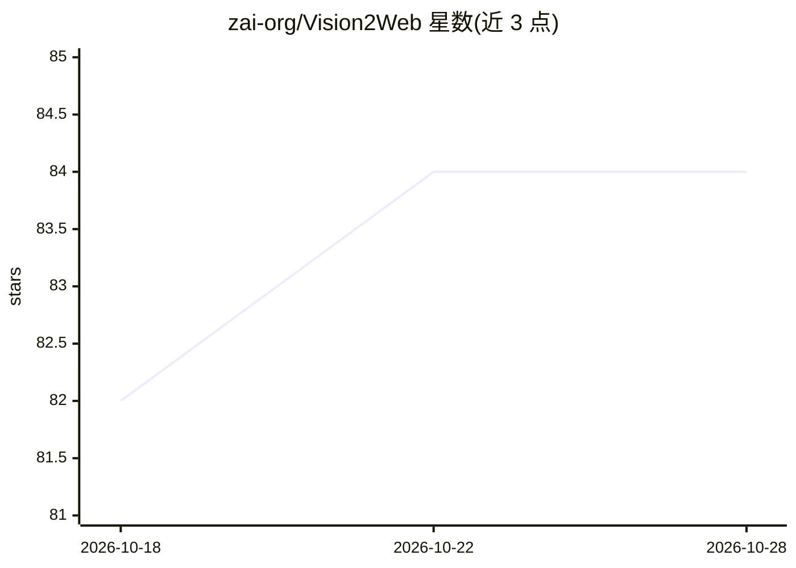

# zai-org/Vision2Web

⭐ 84 · Python · 推送 2026-10-01 · [GitHub](https://github.com/zai-org/Vision2Web) · 组织维护 · 中文 README

**评测多模态编码 agent 视觉网站开发的分层基准（193 任务）**

视觉网站开发领域的分层基准：193 个任务分三级递进——静态网页生成、交互式前端、全栈网站实现，覆盖电商、SaaS、内容、公共服务 4 大领域 16 个子类，配套 918 张原型图与 1,255 个功能测试用例。评测采用工作流式 agent 验证：GUI agent 驱动 playwright-cli 做功能测试，VLM 评审做视觉保真打分。推理支持 Claude Code、Codex、Gemini CLI、OpenHands 四种框架，可经 LiteLLM 代理统一路由。数据集 CC-BY-NC-SA-4.0，仅限学术研究，禁止商用。ICML 2026 Spotlight 论文。面向 agent 研究与评测人员。

## 筛选速览

| 维度 | 判定 | 备注 |
|---|---|---|
| AI 角色 | `ai-ecosystem` | LLM/agent 周边工具 |
| 许可风险 | `none` | — |
| 部署形态 | `library` | 以包/库形式分发 |
| 模型依赖 | locked-api |  |
| 硬件要求 | — | 无带数字的原话,不猜 |
| 安装摩擦 | `low` | 无编译、无系统依赖或容器化 |
| 成熟度 | — | 结构信号不足 |

## 能力要点

- 三级递进任务：静态网页/交互前端/全栈网站
- 193 任务、918 原型图、1,255 功能测试用例
- GUI agent 验证 + VLM 评审的双阶段评测
- 支持 Claude Code / Codex / Gemini CLI / OpenHands 四种推理框架

## 适用场景

- 评测多模态编码 agent 在长程网站开发任务的表现
- 向官方排行榜提交 agent 推理结果
- 复现论文中的基准实验结果

## 场景标签

`模型评测` · 领域:评测与运维

## 证据(README 行号)

> L9: Vision2Web is a comprehensive benchmark designed to evaluate multimodal coding agents on visual website development 
> L20: Vision2Web is a hierarchical benchmark for evaluating multimodal coding agents on end-to-end visual website develop
> L33: Evaluation is conducted via a workflow-based agent verification paradigm that combines GUI agent verifiers for func

## 星数曲线

2026-10-18 82 → 2026-10-28 84（+2）

---
*卡片 v1 · prompt 1.4 · 生成 2026-10-24 · 置信度 high · 依据 README sha `a30165aa0b46` · [字段定义](../../DATASET.md)*
