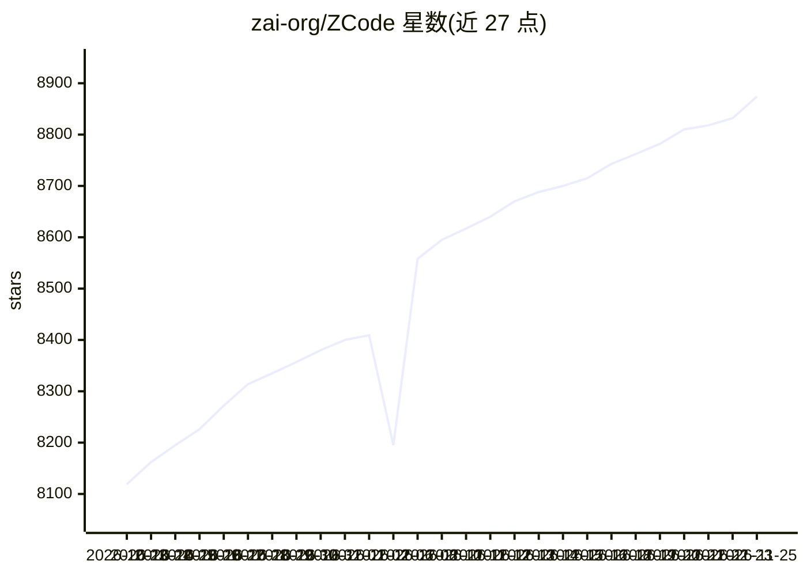

# zai-org/ZCode

⭐ 8,874 · TypeScript · Apache-2.0 · 推送 2026-11-23 · [GitHub](https://github.com/zai-org/ZCode) · [官网](https://zcode.z.ai/) · 组织维护 · 中文 README

**Z.ai 的 AI 编程工作台：桌面、Web 与终端 Agent**

ZCode 是 AI 编程工作台，仓库包含 Electron 桌面客户端、Web 界面、HTTP/WebSocket 后端服务、共享 UI，以及 Agent CLI 与运行时源码。命令行发行包统一以 zcode 启动，无参数进入 TUI，--web 启动浏览器界面，均在本机运行无需 Electron；Web 模式支持局域网访问与令牌认证。支持 SSH/WSL 远程连接、UI Plugin 扩展机制，通过 pnpm workspace 组织，需 Node.js 24.14.0 与 pnpm 10.33.2 构建。

## 筛选速览

| 维度 | 判定 | 备注 |
|---|---|---|
| AI 角色 | `ai-ecosystem` | LLM/agent 周边工具 |
| 许可风险 | `permissive` | Apache-2.0 |
| 部署形态 | `desktop` | 安装包/桌面程序 |
| 模型依赖 | — | README 未给出锁定关系 |
| 硬件要求 | — | 无带数字的原话,不猜 |
| 安装摩擦 | `low` | 无编译、无系统依赖或容器化 |
| 成熟度 | — | 结构信号不足 |

## 能力要点

- 提供桌面应用、浏览器界面和终端 Agent 三种形态
- 命令行发行包统一 zcode 入口：TUI / Web / Agent CLI
- SSH/WSL 远程功能与 UI Plugin 插件机制
- pnpm workspace 单仓管理客户端、后端与 CLI 源码

## 适用场景

- 在桌面或终端中使用 AI Agent 辅助编写代码
- 通过浏览器界面在局域网内访问本机编程 Agent
- 开发 UI Plugin 扩展工作台能力

## 场景标签

`编码 Agent` `AI 助手` · 领域:编码与开发

## 证据(README 行号)

> L10: ZCode 是 AI 编程工作台，提供桌面应用、浏览器界面和终端 Agent。本仓库包含客户端、后端服务、共享 UI，以及 Agent CLI 与运行时源码。
> L91: 命令行发行包包含 TUI、Web 和 Agent，统一使用 `zcode` 启动：无参数进入 TUI；第一个参数为 `--web` 时启动 Web；其他参数交给现有 Agent CLI 处理。两种模式都在本机运行，无需 Elect

## 星数曲线

2026-10-23 8,119 → 2026-11-25 8,874（+755）

---
*卡片 v1 · prompt 1.4 · 生成 2026-11-24 · 置信度 mid · 依据 README sha `1b8fd27cb955` · [字段定义](../../DATASET.md)*
