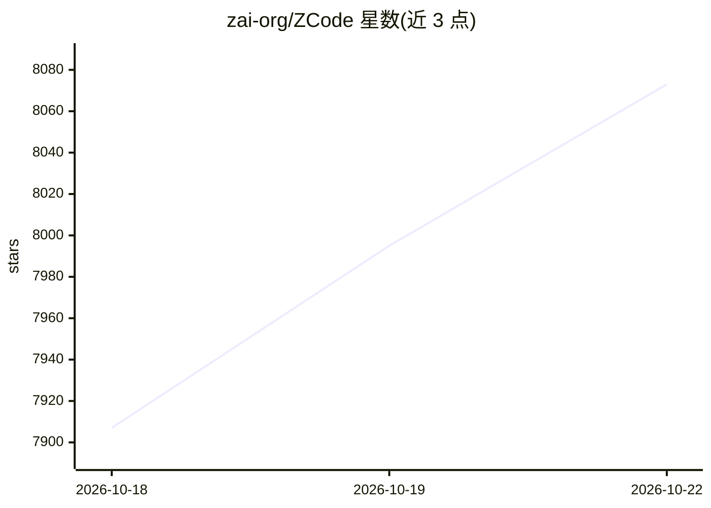

# zai-org/ZCode

⭐ 8,073 · TypeScript · Apache-2.0 · 推送 2026-10-20 · [GitHub](https://github.com/zai-org/ZCode) · [官网](https://zcode.z.ai/) · 组织维护 · 中文 README

**Z.ai 的 AI 编程工作台：桌面/Web/终端三种形态的 coding agent**

Z.ai 开源的 AI 编程工作台，仓库包含 Electron 桌面客户端、Web 客户端、HTTP/WebSocket 后端、共享 UI 与 Agent CLI 运行时源码。命令行发行包统一以 zcode 命令启动：无参数进入 TUI，--web 启动 Web 服务，其余参数交给 Agent CLI；本机运行无需 Electron。支持 SSH/WSL 远程工作区、UI 插件体系与 Provider 配置。开发需 Git、Node.js 24.14.0 与 pnpm 10.33.2（以 mise.toml 为准），通过 pnpm bootstrap 初始化并构建。

## 筛选速览

| 维度 | 判定 | 备注 |
|---|---|---|
| AI 角色 | `ai-native` | 本体是模型或模型工具 |
| 许可风险 | `permissive` | Apache-2.0 |
| 部署形态 | `desktop` | 安装包/桌面程序 |
| 模型依赖 | — | README 未给出锁定关系 |
| 硬件要求 | — | 无带数字的原话,不猜 |
| 安装摩擦 | `low` | 无编译、无系统依赖或容器化 |
| 成熟度 | — | 结构信号不足 |

## 能力要点

- 桌面/Web/TUI 三形态共享同一 Agent CLI 与运行时
- SSH/WSL 远程工作区支持，资源经 SFTP 上传
- CLI 发行包含版本索引与 install.sh 安装脚本，含 sha256 校验
- UI Plugin 开发体系与 zcode-plugins 插件提交流程

## 适用场景

- 用桌面或 Web 工作台进行 AI 辅助编程
- 在服务器/WSL 远程环境中连接项目做开发
- 通过 zcode 命令在终端运行 Agent 与自托管 Web 界面
- 为其开发 UI 插件扩展工作台功能

## 场景标签

`编码 Agent` · 领域:编码与开发

## 证据(README 行号)

> L10: ZCode 是 AI 编程工作台，提供桌面应用、浏览器界面和终端 Agent。本仓库包含客户端、后端服务、共享 UI，以及 Agent CLI 与运行时源码。
> L82: 命令行发行包包含 TUI、Web 和 Agent，统一使用 `zcode` 启动：无参数进入 TUI；第一个参数为 `--web` 时启动 Web；其他参数交给现有 Agent CLI 处理。两种模式都在本机运行，无需 Elect

## 星数曲线

2026-10-18 7,907 → 2026-10-22 8,073（+166）

---
*卡片 v1 · prompt 1.4 · 生成 2026-10-20 · 置信度 mid · 依据 README sha `dc92d7a761ec` · [字段定义](../../DATASET.md)*
