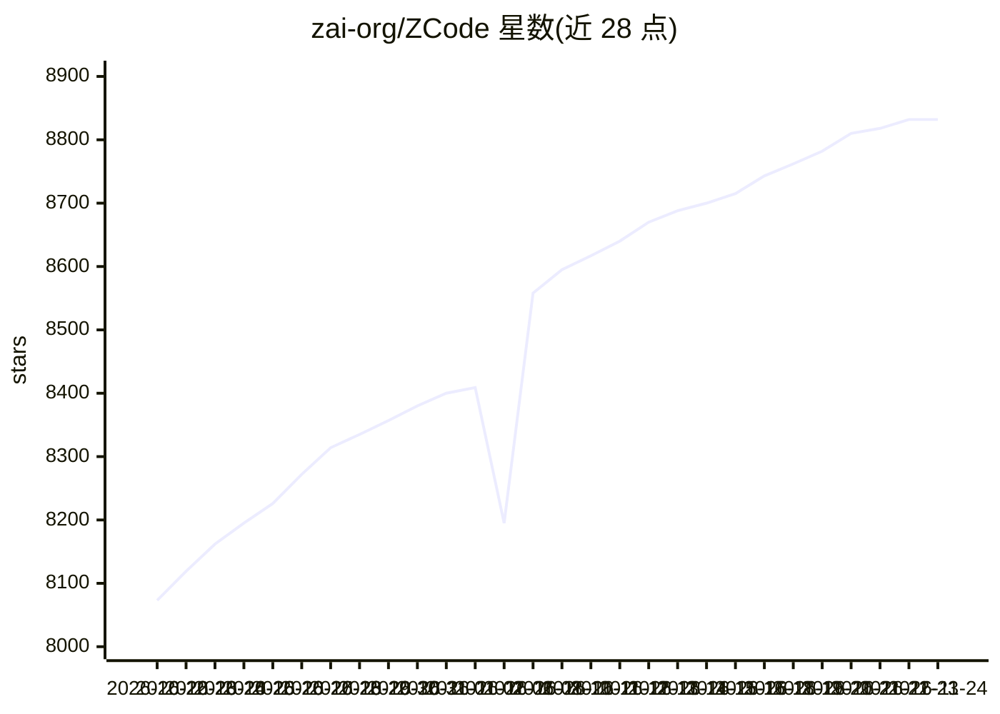

# zai-org/ZCode

⭐ 8,832 · TypeScript · Apache-2.0 · 推送 2026-11-16 · [GitHub](https://github.com/zai-org/ZCode) · [官网](https://zcode.z.ai/) · 组织维护 · 中文 README

**Z.ai 的 AI 编程工作台：桌面/Web/终端多形态 Agent**

ZCode 是一个 AI 编程工作台仓库，包含 Electron 桌面客户端、Web 客户端、HTTP/WebSocket 后端服务，以及 Agent CLI 与运行时源码。命令行发行包统一用 `zcode` 启动：无参数进入 TUI，`--web` 启动浏览器界面（监听 127.0.0.1，支持令牌认证与局域网 --host 配置）。支持 SSH/WSL 远程连接工作区（资源经 SFTP 上传），支持 UI Plugin 扩展机制（含 Excalidraw 画布协作示例）。基于 Git、Node.js 24.14.0 与 pnpm 构建，桌面打包支持 macOS/Windows/Linux 与 x64/arm64。

## 筛选速览

| 维度 | 判定 | 备注 |
|---|---|---|
| AI 角色 | `ai-native` | 本体是模型或模型工具 |
| 许可风险 | `permissive` | Apache-2.0 |
| 部署形态 | `desktop` | 安装包/桌面程序 |
| 模型依赖 | — | README 未给出锁定关系 |
| 硬件要求 | — | 无带数字的原话,不猜 |
| 安装摩擦 | `low` | 无编译、无系统依赖或容器化 |
| 成熟度 | — | 结构信号不足 |

## 能力要点

- 桌面（Electron）、浏览器 Web、终端 TUI 三种使用形态，`zcode` 命令统一入口
- SSH/WSL 远程工作区连接，资源经 SFTP 上传
- UI Plugin 扩展机制与独立插件仓库 zcode-plugins
- 自建发行流程：tar.gz 运行包、sha256 校验、install.sh 安装脚本

## 适用场景

- 在终端里用 TUI 与编程 Agent 交互完成编码任务
- 通过浏览器界面在局域网内访问本机 Agent 服务
- 远程连接 SSH/WSL 中的项目进行开发

## 场景标签

`编码 Agent` · 领域:编码与开发

## 证据(README 行号)

> L10: ZCode 是 AI 编程工作台，提供桌面应用、浏览器界面和终端 Agent。本仓库包含客户端、后端服务、共享 UI，以及 Agent CLI 与运行时源码。
> L90: 命令行发行包包含 TUI、Web 和 Agent，统一使用 `zcode` 启动：无参数进入 TUI；第一个参数为 `--web` 时启动 Web；其他参数交给现有 Agent CLI 处理。两种模式都在本机运行，无需 Elect

## 星数曲线

2026-10-22 8,073 → 2026-11-24 8,832（+759）

---
*卡片 v1 · prompt 1.4 · 生成 2026-11-22 · 置信度 high · 依据 README sha `2fe20af167dd` · [字段定义](../../DATASET.md)*
