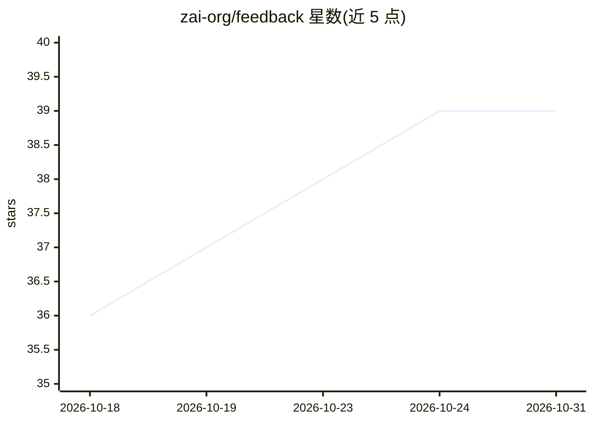

# zai-org/feedback

⭐ 39 · NOASSERTION · 推送 2026-08-17 · [GitHub](https://github.com/zai-org/feedback) · 组织维护 · 中文 README

**ZCode 官方用户反馈收集仓库，处理状态全程公开**

Z.ai 官方维护的 ZCode 反馈中心：通过 GitHub Issues 与 Discussions 收集功能建议、Bug 报告与使用问题。每个 issue 带 status 标签（待评估/已采纳/开发中/已上线/已拒绝），可在项目看板跟踪进度，被拒绝的建议会在评论区给出书面理由。标签体系覆盖类型、严重度、优先级、产品类别（对话、工具/MCP、模型、计费等）与 Agent 框架来源。仓库还含 ROADMAP、CHANGELOG、贡献指南与安全报告等文档，内容以 CC BY 4.0 授权。

## 筛选速览

| 维度 | 判定 | 备注 |
|---|---|---|
| AI 角色 | `ai-ecosystem` | LLM/agent 周边工具 |
| 许可风险 | `none` | NOASSERTION |
| 部署形态 | `None` |  |
| 模型依赖 | — | README 未给出锁定关系 |
| 硬件要求 | — | 无带数字的原话,不猜 |
| 安装摩擦 | `low` | 无编译、无系统依赖或容器化 |
| 成熟度 | — | 结构信号不足 |

## 能力要点

- 五级 status 标签 + 项目看板实现处理状态公开跟踪
- 拒绝建议附书面理由
- 标签覆盖类别、严重度、优先级与 Agent 框架来源
- 附 ROADMAP / CHANGELOG / SECURITY 等配套文档

## 适用场景

- 向 ZCode 提交功能建议或 Bug 报告
- 查询自己反馈的处理进度
- 了解 ZCode 的路线图与近期更新

## 场景标签

 · 领域:AI 编程工具/社区管理

## 证据(README 行号)

> L5: **The official ZCode feedback hub for suggestions, bug reports, usage questions, and transparent progress tracking.*
> L69: `fw: ZCode Agent` · `fw: Claude Code` · `fw: Codex` · `fw: opencode` · `fw: Gemini CLI`

## 星数曲线

2026-10-18 36 → 2026-10-31 39（+3）

---
*卡片 v1 · prompt 1.4 · 生成 2026-10-25 · 置信度 mid · 依据 README sha `520b360c21ae` · [字段定义](../../DATASET.md)*
