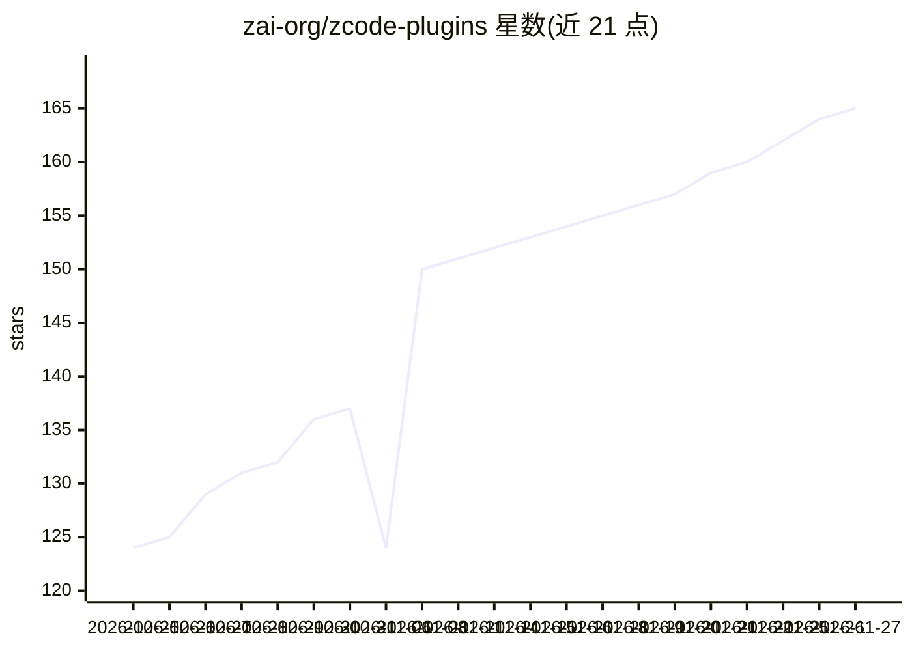

# zai-org/zcode-plugins

⭐ 165 · Python · Apache-2.0 · 推送 2026-11-24 · [GitHub](https://github.com/zai-org/zcode-plugins) · 组织维护 · 中文 README

**ZCode 的官方插件市场：浏览、安装与贡献插件**

ZCode 的官方插件市场仓库，收录 ZCode 官方维护与社区贡献的插件，涵盖开发者工具（CloudBase、GitHub、GitLab、阿里云 CLI）、办公协作 CLI（飞书、钉钉、企微）、UI 插件（Excalidraw、OpenPencil、九个 Craft 系列）与十个金融领域插件。ZCode 内置该市场，可在插件管理器中直接安装；源码开发需 Node.js 24+ 与 pnpm 10.33.2，UI 插件的 dist 构建产物不随仓库分发，需自行构建。许可为 Apache 2.0。

## 筛选速览

| 维度 | 判定 | 备注 |
|---|---|---|
| AI 角色 | `ai-ecosystem` | LLM/agent 周边工具 |
| 许可风险 | `permissive` | Apache-2.0 |
| 部署形态 | `library` | 以包/库形式分发 |
| 模型依赖 | — | README 未给出锁定关系 |
| 硬件要求 | — | 无带数字的原话,不猜 |
| 安装摩擦 | `low` | 无编译、无系统依赖或容器化 |
| 成熟度 | — | 结构信号不足 |

## 能力要点

- 收录开发者工具、协作 CLI、UI 与金融四类插件
- 九个 Craft 插件内嵌固定版本的 Trunk/WASM 编辑器，连接 334 个上游 MCP 工具定义
- 金融插件通过 ZCode host 认证远程行情 MCP 服务器，无需配置数据商账户
- 提供中文的贡献指南、分发格式与插件开发教程

## 适用场景

- 在 ZCode 插件管理器中安装 GitHub/GitLab 等工作流插件
- 为 ZCode 开发并注册自己的插件到本地市场
- 使用金融插件做股票研究、基金筛选或月末结账复核

## 场景标签

`金融量化` · 领域:学习与行业

## 证据(README 行号)

> L5: The official plugins marketplace for ZCode, featuring plugins maintained by ZCode and contributions from the communi
> L36: - `zcode-mcp-app-dev` `0.1.1`: Develop MCP Apps for ZCode with official SDKs and a small host-extension reference.
> L48: These nine Craft plugins embed pinned Trunk/WASM editors, with workspace imports, saves and all 334 upstream MCP to

## 星数曲线

2026-10-25 124 → 2026-11-27 165（+41）

---
*卡片 v1 · prompt 1.4 · 生成 2026-11-27 · 置信度 mid · 依据 README sha `83e656e1556b` · [字段定义](../../DATASET.md)*
