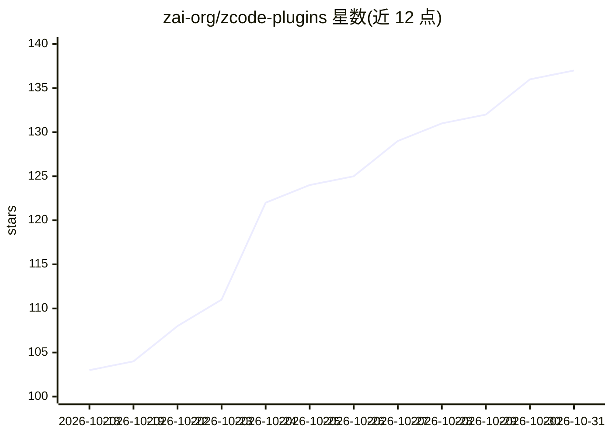

# zai-org/zcode-plugins

⭐ 137 · Python · Apache-2.0 · 推送 2026-10-29 · [GitHub](https://github.com/zai-org/zcode-plugins) · 组织维护 · 中文 README

**ZCode 官方插件市场：浏览、安装与共建 ZCode 插件**

zai-org 维护的 ZCode 插件市场仓库，收录官方内置与社区插件：开发者工具类（CloudBase MCP、GitHub/GitLab/阿里云 CLI 工作流、安全护栏 mimosa）、生产力类（Blender MCP、video2code 网页复刻）、UI 插件（Excalidraw、OpenPencil 及九个 Craft 系列内嵌 Trunk/WASM 编辑器并接通 334 个上游 MCP 工具定义）以及十个金融插件（配路由 agent、领域技能与行情数据 MCP，多数需付费套餐）。README 提供插件清单、分类说明与源码构建（Node.js 24+/pnpm）流程，ZCode 客户端内可直接安装。

## 筛选速览

| 维度 | 判定 | 备注 |
|---|---|---|
| AI 角色 | `ai-ecosystem` | LLM/agent 周边工具 |
| 许可风险 | `permissive` | Apache-2.0 |
| 部署形态 | `library` | 以包/库形式分发 |
| 模型依赖 | — | README 未给出锁定关系 |
| 硬件要求 | — | 无带数字的原话,不猜 |
| 安装摩擦 | `low` | 无编译、无系统依赖或容器化 |
| 成熟度 | — | 结构信号不足 |

## 能力要点

- 收录官方与社区插件并按 6 个 category 组织（developer-tools/finance 等）
- 九个 Craft UI 插件内嵌固定版本 Trunk/WASM 编辑器，接通 334 个上游 MCP 工具定义
- 十个金融插件各配路由 agent、领域技能与经 ZCode 主机鉴权的行情数据 MCP 服务器
- UI 插件 dist 产物不入库，由发布流水线构建；源码开发用 Node.js 24+ 与 pnpm

## 适用场景

- 在 ZCode 客户端里浏览并安装官方或社区插件
- 按分类为开发、生产力或金融工作流挑选插件
- 通过 PR 提交自己的插件到官方市场
- 从源码构建插件并在本地市场测试

## 场景标签

 · 领域:开发者工具/AI 编码客户端生态

## 证据(README 行号)

> L5: The official plugins marketplace for ZCode, featuring plugins maintained by ZCode and contributions from the communi
> L20: |**cloudbase-skills**|`developer-tools`|CloudBase development skills and MCP integration for Web, Mini Program, dat
> L56: corporate finance function. Each pairs one routing agent with domain skills and, except

## 星数曲线

2026-10-18 103 → 2026-10-31 137（+34）

---
*卡片 v1 · prompt 1.4 · 生成 2026-10-23 · 置信度 mid · 依据 README sha `40c48560432c` · [字段定义](../../DATASET.md)*
