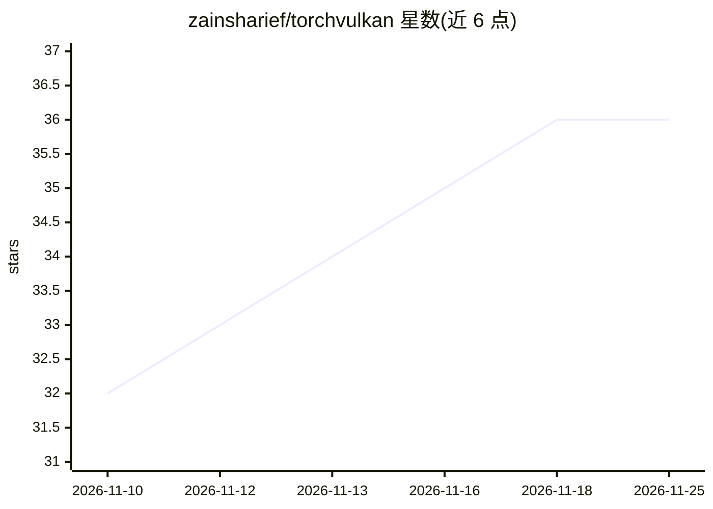

# zainsharief/torchvulkan

⭐ 36 · C++ · MIT · 推送 2026-11-23 · [GitHub](https://github.com/zainsharief/torchvulkan) · 个人维护

**为 PyTorch 注册跨平台 Vulkan GPU 后端的扩展库**

Python 包，import 后在 PyTorch 中注册 'vulkan' 设备，把张量操作以 Vulkan compute shader 形式在 GPU 上运行，覆盖 Linux/macOS/Windows 上 AMD、Intel、NVIDIA 及 Apple（经 MoltenVK）的 GPU。未原生实现的算子默认回退 CPU，可用 TORCHVULKAN_STRICT 转为报错。自带 MLP/小语言模型/ResNet 端到端训练示例与基准脚本。项目自述为实验性早期阶段，1.0 前可能有破坏性变更；macOS wheel 内置 MoltenVK，其他平台需 Vulkan 1.3+ 驱动。

## 筛选速览

| 维度 | 判定 | 备注 |
|---|---|---|
| AI 角色 | `ai-ecosystem` | LLM/agent 周边工具 |
| 许可风险 | `permissive` | MIT |
| 部署形态 | `library` | 以包/库形式分发 |
| 模型依赖 | — | README 未给出锁定关系 |
| 硬件要求 | — | 无带数字的原话,不猜 |
| 安装摩擦 | `medium` | 含编译或系统依赖之一 |
| 成熟度 | `idea` | |

## 能力要点

- 注册 vulkan 设备，像使用普通 PyTorch 设备一样训练模型
- 单一厂商中立后端覆盖 AMD/Intel/NVIDIA/Apple GPU 与三大桌面系统
- 未覆盖算子自动 CPU 回退，模型在部分覆盖下仍可运行
- 提供 pipeline 缓存、Khronos 验证层等环境变量控制

## 适用场景

- 在没有 CUDA 的 GPU（AMD/Intel/Apple）上运行 PyTorch 训练
- 用一套代码跨 Linux/macOS/Windows 的多厂商 GPU 后端
- 验证工作流在特定 GPU 上的算子覆盖情况（STRICT 模式）

## 场景标签

`模型训练` · 领域:训练与推理

## 证据(README 行号)

> L10: `torchvulkan` registers a `vulkan` device with PyTorch and runs tensor operations as Vulkan compute shaders. Vulkan
> L144: 1. Importing the package registers a PyTorch `PrivateUse1` backend and renames it to `vulkan`.

## 星数曲线

2026-11-10 32 → 2026-11-25 36（+4）

---
*卡片 v1 · prompt 1.4 · 生成 2026-11-18 · 置信度 high · 依据 README sha `c9fae3a32f02` · [字段定义](../../DATASET.md)*
