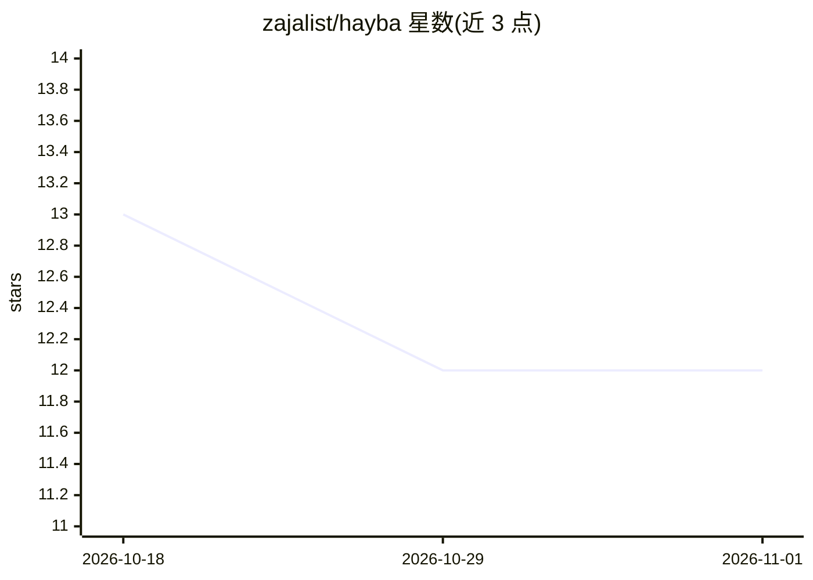

# zajalist/hayba

⭐ 12 · C++ · MIT · 推送 2026-10-25 · [GitHub](https://github.com/zajalist/hayba) · [官网](https://hayba.vercel.app) · 个人维护

**把 MCP agent 接入 Unreal 编辑器的世界构建工具箱**

面向 Unreal Engine 5.7+ 的 Agentic MCP 工具集：TypeScript MCP 服务器将请求路由到 C++ 编辑器插件，让 MCP 客户端（如 Claude Code）检查、规划、构建与验证 UE 世界。提供覆盖 Actor、资产、关卡、蓝图、PCG、材质等域的工具库，配 Plan Mode 审批、owner-bound 租约、PIE/资产占用检查与原生崩溃防护等安全边界，以及基于场景采样网格与深度点的 World 空间视图。需 Node.js 22.5+ 与 Windows VS2022，git clone + npm 构建安装。0.4.0 安全链与编辑器工作区为开发预览。

## 筛选速览

| 维度 | 判定 | 备注 |
|---|---|---|
| AI 角色 | `ai-ecosystem` | LLM/agent 周边工具 |
| 许可风险 | `permissive` | MIT |
| 部署形态 | `library` | 以包/库形式分发 |
| 模型依赖 | — | README 未给出锁定关系 |
| 硬件要求 | — | 无带数字的原话,不猜 |
| 安装摩擦 | `low` | 无编译、无系统依赖或容器化 |
| 成熟度 | `idea` | |

## 能力要点

- TypeScript MCP 服务器 + C++ UE 编辑器插件架构，工具按需发现签名而非整目录加载
- Plan Mode 破坏性操作需审批，支持 UE undo 事务与结构化拒绝返回
- 0.4.0 候选：owner-bound 租约、PIE/资产占用检查、有界批处理与原生故障后的粘性不安全状态
- World 视图：网格表面采样与首屏深度捕获，world_tile_capture / world_semantic_snapshot 按需取几何瓦片

## 适用场景

- 让 Claude 等 MCP agent 在 UE 编辑器中检查关卡并提出可审查的修改方案
- 多 agent 共享编辑器场景下的写入协调与冲突拒绝
- 基于场景采样的空间证据查询（几何瓦片、深度分页、覆盖缺口）

## 场景标签

`GUI 自动化` · 领域:效率与自动化

## 证据(README 行号)

> L7: Inspect, plan, build, and validate Unreal Engine worlds through MCP. Native editor checks keep agent work accountabl
> L41: Two agents route requests through the MCP server to native editor checks; allowed writes reach Unreal Editor and bl
> L43: The TypeScript MCP server routes requests to the C++ editor plugin. The editor plugin checks state and ownership wh

## 星数曲线

2026-10-18 13 → 2026-11-01 12（-1）

---
*卡片 v1 · prompt 1.4 · 生成 2026-10-31 · 置信度 high · 依据 README sha `d5a7e72cb716` · [字段定义](../../DATASET.md)*
