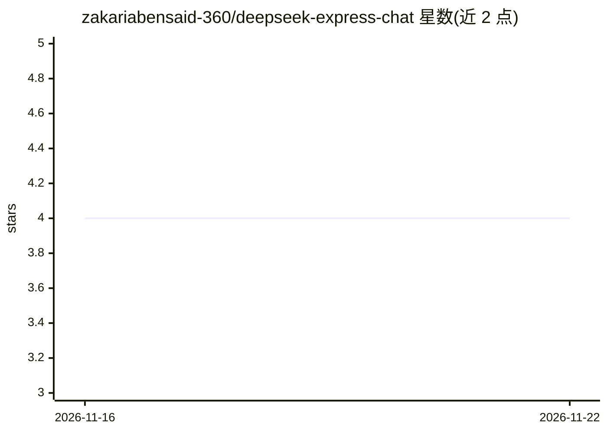

# zakariabensaid-360/deepseek-express-chat

⭐ 4 · HTML · MIT · 推送 2026-11-02 · [GitHub](https://github.com/zakariabensaid-360/deepseek-express-chat) · 个人维护

**本地隐私优先的 DeepSeek 网页聊天界面，经 Ollama 运行**

基于 Express.js 与 Tailwind CSS 构建的本地聊天 Web 界面，通过 Ollama 在用户本机运行 DeepSeek-R1 模型，无需云端 API key。README 要求先安装 Ollama 作为托管 DeepSeek 模型权重的本地后端，并拉取默认模型 deepseek-r1:1.5b，之后用 node main.js 启动应用。界面声明 100% 本地执行，支持 Windows/macOS/Linux 三种系统安装 Ollama。

## 筛选速览

| 维度 | 判定 | 备注 |
|---|---|---|
| AI 角色 | `ai-native` | 本体是模型或模型工具 |
| 许可风险 | `permissive` | MIT |
| 部署形态 | `None` |  |
| 模型依赖 | local-ok | 支持本地模型 |
| 硬件要求 | — | 无带数字的原话,不猜 |
| 安装摩擦 | `low` | 无编译、无系统依赖或容器化 |
| 成熟度 | — | 结构信号不足 |

## 能力要点

- 通过 Ollama 100% 本地运行，无需云端 API key
- 默认支持 deepseek-r1:1.5b 模型
- Express.js + Tailwind CSS CDN 的轻量架构

## 适用场景

- 在本机私有环境下与 DeepSeek 模型对话
- 不依赖云服务 API key 的本地 LLM 前端搭建

## 场景标签

`聊天机器人` · 领域:对话与助手

## 证据(README 行号)

> L3: A fast, responsive web interface built with **Express.js**, **Tailwind CSS**, and **Ollama**. Chat locally with **De
> L7: - **100% Local Execution:** Runs entirely on your hardware via Ollama.

## 星数曲线

2026-11-16 4 → 2026-11-22 4（+0）

---
*卡片 v1 · prompt 1.4 · 生成 2026-11-21 · 置信度 high · 依据 README sha `65782f830b8e` · [字段定义](../../DATASET.md)*
