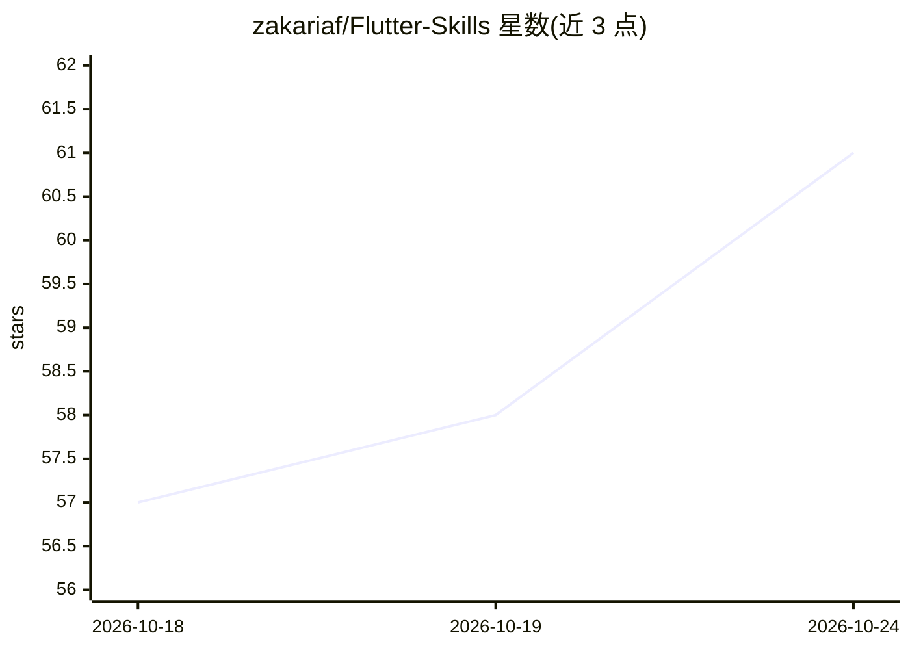

# zakariaf/Flutter-Skills

⭐ 62 · Dart · MIT · 推送 2026-09-23 · [GitHub](https://github.com/zakariaf/Flutter-Skills) · [官网](https://zakaria.dev/Flutter-Skills/) · 个人维护

**面向 AI 编码代理的 Flutter 工程技能集（40 个 SKILL.md）**

基于 Agent Skills 开放标准的 Flutter/Dart 工程技能合集，共 40 个技能，覆盖架构、Riverpod 3.x 状态管理、测试、Drift 持久化、i18n/RTL、无障碍、导航、性能与上架变现等。每个技能是一个 SKILL.md playbook，代理仅在任务匹配时加载；rich 技能附带 references/examples/可运行脚本，manual-only 技能为人工触发的运维 runbook。技能由十余个生产 Flutter 应用的私有技能库蒸馏合并而成，同一文件可在 Claude Code、Cursor、Codex 等 70+ 代理工具中使用。

## 筛选速览

| 维度 | 判定 | 备注 |
|---|---|---|
| AI 角色 | `ai-knowledge` | 知识聚合/清单类 |
| 许可风险 | `permissive` | MIT |
| 部署形态 | `library` | 以包/库形式分发 |
| 模型依赖 | — | README 未给出锁定关系 |
| 硬件要求 | — | 无带数字的原话,不猜 |
| 安装摩擦 | `low` | 无编译、无系统依赖或容器化 |
| 成熟度 | — | 结构信号不足 |

## 能力要点

- 40 个技能按核心 Flutter/Dart、架构、数据、测试、i18n/无障碍、上架变现等类别组织
- 基于 Agent Skills 开放标准，兼容 Claude Code、Cursor、Codex、Copilot 等 70+ 代理工具
- 技能源自十余个生产应用的私有技能库合并与对抗性审查
- 通过 npx skills add 命令行安装，支持全量、浏览或单个技能安装

## 适用场景

- 为我的编码代理配置 Flutter 工程规范，让规则跨会话一致执行
- 在 Claude Code/Cursor 等工具中加载 Riverpod 3.x、Drift、测试等最佳实践
- 按任务匹配按需加载技能，避免上下文膨胀

## 场景标签

`提示工程` · 领域:Agent 开发

## 证据(README 行号)

> L11: Each skill is a short, high-signal playbook that an agent loads **only when your task matches it**,
> L15: Built on the **Agent Skills** open standard, so the same files work in
> L16: **Claude Code, Cursor, Codex, Copilot, Gemini CLI, Windsurf, Cline, OpenCode** and 70+ more — not

## 星数曲线

2026-10-18 57 → 2026-10-24 61（+4）

---
*卡片 v1 · prompt 1.4 · 生成 2026-10-24 · 置信度 high · 依据 README sha `0cc3aa854290` · [字段定义](../../DATASET.md)*
