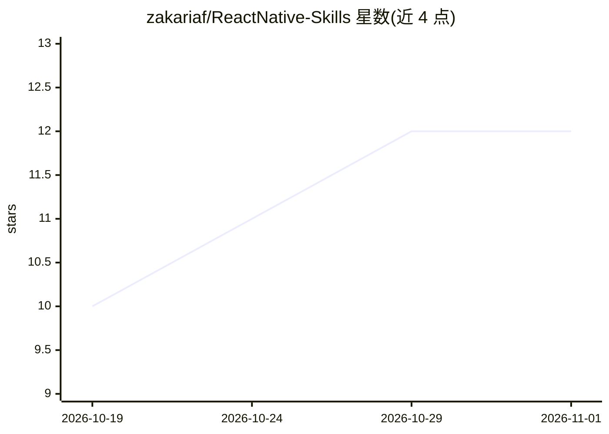

# zakariaf/ReactNative-Skills

⭐ 12 · JavaScript · MIT · 推送 2026-10-21 · [GitHub](https://github.com/zakariaf/ReactNative-Skills) · [官网](https://zakaria.dev/ReactNative-Skills/) · 个人维护

**面向 AI 编程 agent 的 React Native/Expo 工程技能库（79 个自带校验器）**

为 Claude Code、Codex 及任何读取 Agent Skills 标准的编程 agent 提供 79 个 React Native/Expo 工程技能（playbook）：每个技能含规则、工作流、模板与完成定义，并以零依赖 Node 校验脚本输出 PASS/FAIL 证明结果；校验器经过植入 bug 的自测，模板在参考 Expo SDK 57 应用中编译验证。覆盖架构、Expo Router、Zustand、TanStack Query、测试、i18n/RTL、无障碍、EAS 发布及可选游戏技能。通过 Claude Code 插件市场、Codex 插件或 npx skills add 安装。

## 筛选速览

| 维度 | 判定 | 备注 |
|---|---|---|
| AI 角色 | `ai-knowledge` | 知识聚合/清单类 |
| 许可风险 | `permissive` | MIT |
| 部署形态 | `library` | 以包/库形式分发 |
| 模型依赖 | — | README 未给出锁定关系 |
| 硬件要求 | — | 无带数字的原话,不猜 |
| 安装摩擦 | `high` | 编译与系统依赖俱全 |
| 成熟度 | — | 结构信号不足 |

## 能力要点

- 每个技能以零依赖 Node 校验脚本输出 RESULT: PASS/FAIL 作为完成定义
- 校验器通过植入 bug 的 fixture 自测，模板在参考 Expo SDK 57 应用中通过 TS/ESLint/Jest 验证
- 单一技术栈（Expo Router/Zustand/TanStack Query 等）在 79 个技能间保持一致
- 支持 Claude Code 插件市场、Codex 插件与 npx skills add 三种安装方式

## 适用场景

- 让编程 agent 按 playbook 完成 React Native/Expo 开发任务并用校验器自证
- 新 Expo 应用从空仓库引导到发布
- 为 agent 注入 i18n/RTL、无障碍、测试、EAS 发布等工程规范

## 场景标签

 · 领域:移动开发/AI agent 技能

## 证据(README 行号)

> L3: **Deep, self-verifying engineering skills for React Native apps built with Expo, for Claude Code, Codex and any agen
> L11: Each skill is a playbook an agent loads only when a task matches its description: rules with their
> L17: - **Every skill ends in a checker.** The definition of done is a zero-dependency Node script that

## 星数曲线

2026-10-19 10 → 2026-11-01 12（+2）

---
*卡片 v1 · prompt 1.4 · 生成 2026-10-31 · 置信度 high · 依据 README sha `c8a10a8714ea` · [字段定义](../../DATASET.md)*
