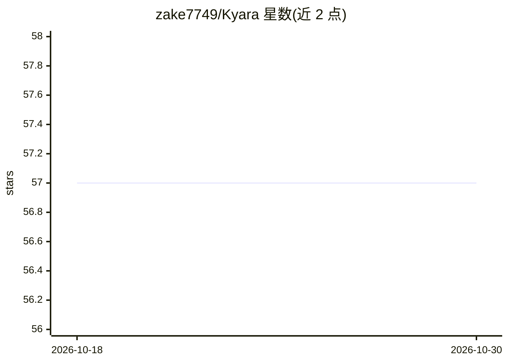

# zake7749/Kyara

⭐ 57 · Jupyter Notebook · MIT · 推送 2026-08-22 · [GitHub](https://github.com/zake7749/Kyara) · 个人维护 · 中文 README

**基于 Gemma-2 微调的繁体中文 LLM（2B/9B），Kaggle 调优赛第二名**

以 Gemma-2 为基座、面向中文（尤以繁体）微调的对话模型系列，提供 2B 与 9B 指令版本，在 Kaggle 'Unlock Global Communication with Gemma' 比赛中获第二名，模型与训练数据集均开源。方法上基于检索增强合成了约 362 万则对话（约 4.51B tokens），经两阶段 SFT 与 DPO 偏好学习训练，SFT 阶段混入 RAG 语料使模型支持带引用格式的检索增强生成（实验性）。推理兼容 transformers pipeline，沿用 Gemma-2 架构的官方教程。README 自述存在幻觉问题，建议谨慎判断输出。

## 筛选速览

| 维度 | 判定 | 备注 |
|---|---|---|
| AI 角色 | `ai-native` | 本体是模型或模型工具 |
| 许可风险 | `permissive` | MIT |
| 部署形态 | `None` |  |
| 模型依赖 | — | README 未给出锁定关系 |
| 硬件要求 | — | 无带数字的原话,不猜 |
| 安装摩擦 | `low` | 无编译、无系统依赖或容器化 |
| 成熟度 | — | 结构信号不足 |

## 能力要点

- 2B 与 9B 指令模型，繁体中文与简体中文均提供评测
- 基于检索增强合成约 362 万则对话、约 4.51B tokens 训练数据并开源
- 两阶段 SFT（Base + 高品质 Subset）加 DPO 偏好学习
- 实验性 RAG 能力：支持带文档引用标记的任务模板

## 适用场景

- 繁体中文对话、写作、摘要与开放问答
- 需要本地部署的中小参数量中文模型
- 研究中文 LLM 的检索增强数据合成与偏好学习流程

## 场景标签

 · 领域:自然语言处理/大语言模型

## 证据(README 行号)

> L9: 🎉 **News:** Kyara achieved **2nd place** in the Kaggle competition Google - Unlock Global Communication with Gemma, 
> L69: Kyara 採用了和 Gemma2 一樣的架構，因此在推理上可以沿用 Google 的官方教學。此外，我們也在 Kaggle 上提供了一個 Jupyter Notebook ，演示 Kyara 的各項基本功能，如寫作、摘要、開放式
> L121: 上述策略雖然能廣泛生成知識性文本，但主要屬於資訊尋求（Information Seeking）的任務範疇，不太能有效構建數學與推理相關的語料。為此，我們基於 PersonaHub 產生了 5 萬則數學題，並借助 `Gemini-

## 星数曲线

2026-10-18 57 → 2026-10-30 57（+0）

---
*卡片 v1 · prompt 1.4 · 生成 2026-10-24 · 置信度 high · 依据 README sha `92260483854e` · [字段定义](../../DATASET.md)*
