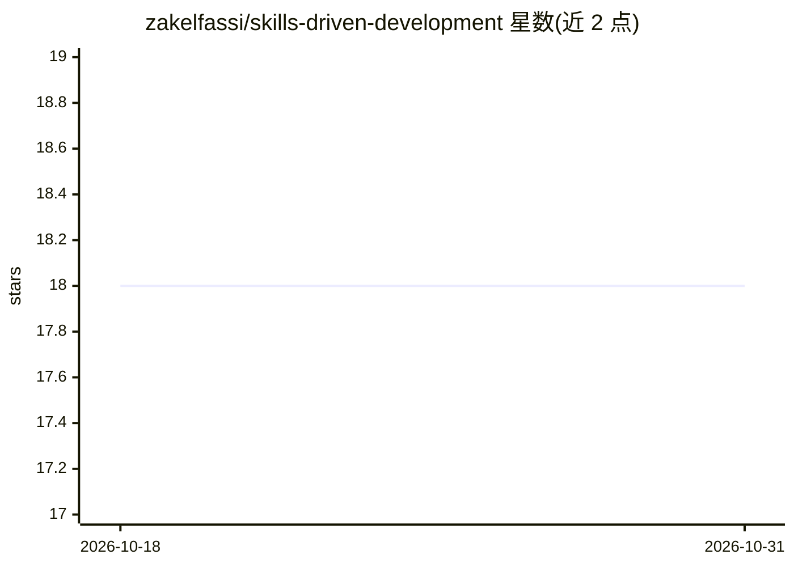

# zakelfassi/skills-driven-development

⭐ 18 · TypeScript · MIT · 推送 2026-07-16 · [GitHub](https://github.com/zakelfassi/skills-driven-development) · [官网](https://skdd.dev) · 个人维护

**让 AI agent 在工作中自创、演化并共享可复用技能的方法学与 CLI**

Skills-Driven Development（SkDD）是一套让 AI agent 在实际工作中按需创建、演化、共享可复用技能（SKILL.md 格式，遵循开放 Agent Skills 规范）的方法学，配套 TypeScript CLI（npm 发布 @zakelfassi/skdd）。核心机制：skillforge 让 agent 自主锻造技能；单一 skills/ 目录通过镜像兼容 Claude Code、Codex、Cursor 等 9 种 harness；1.0 提供全局 colony（~/.skdd/）统一管理技能与 MCP 服务器配置，skdd hub 提供 TUI 界面。社区技能以 dated drops 形式发布于 SkDD Commons，可推送演化回上游。需 Node ≥ 20，MIT 许可。

## 筛选速览

| 维度 | 判定 | 备注 |
|---|---|---|
| AI 角色 | `ai-ecosystem` | LLM/agent 周边工具 |
| 许可风险 | `permissive` | MIT |
| 部署形态 | `library` | 以包/库形式分发 |
| 模型依赖 | — | README 未给出锁定关系 |
| 硬件要求 | — | 无带数字的原话,不猜 |
| 安装摩擦 | `low` | 无编译、无系统依赖或容器化 |
| 成熟度 | — | 结构信号不足 |

## 能力要点

- agent 自主锻造/演化 SKILL.md 技能的 skillforge 元技能
- 单一 skills/ 目录镜像到 9 种 harness（Claude Code/Codex/Cursor 等）
- 全局 colony（~/.skdd/）统一管理技能与 MCP 服务器配置（7 种 MCP host 适配）
- skdd hub Ink TUI：技能、镜像状态、MCP 矩阵、doctor 报告四窗格

## 适用场景

- 让编码 agent 在项目中沉淀重复操作为可复用技能
- 跨项目、跨多种 AI 编码工具共享同一套技能库
- 统一管理多 harness 的 MCP 服务器配置

## 场景标签

`Agent 框架` `提示工程` · 领域:Agent 开发

## 证据(README 行号)

> L19: **Skills-Driven Development (SkDD)** is a methodology where AI agents **create, evolve, and share reusable skills**
> L81: SkDD 1.0 ships a **global colony** at `~/.skdd/` — one canonical place to manage skills and MCP servers across ever
> L118: SkDD works in any harness that understands the Agent Skills spec. Skills live in a single canonical `skills/` dire

## 星数曲线

2026-10-18 18 → 2026-10-31 18（+0）

---
*卡片 v1 · prompt 1.4 · 生成 2026-10-29 · 置信度 high · 依据 README sha `fa2b7aa19536` · [字段定义](../../DATASET.md)*
