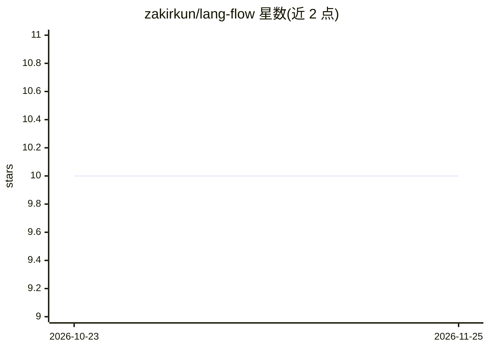

# zakirkun/lang-flow

⭐ 10 · TypeScript · MIT · 推送 2026-01-23 · [GitHub](https://github.com/zakirkun/lang-flow) · 个人维护

**为渗透测试人员提供 AI 驱动的安全工作流自动化平台**

结合命令行安全工具与 AI 分析的渗透测试工作流平台：前端 React/Vite 提供拖拽式可视化工作流编辑器，后端 FastAPI 通过 LangChain 调用 OpenAI 多个模型。工作流由 AI 步骤、命令步骤（支持变量模板引用前序输出）、报告步骤组成，WebSocket 实时监控执行，结果可经 SMTP/Telegram/Slack 多渠道发送，并生成含风险评级的 PDF 报告。需自备 OpenAI API key；README 警告其可执行任意命令，应在受控环境运行。

## 筛选速览

| 维度 | 判定 | 备注 |
|---|---|---|
| AI 角色 | `ai-native` | 本体是模型或模型工具 |
| 许可风险 | `permissive` | MIT |
| 部署形态 | `library` | 以包/库形式分发 |
| 模型依赖 | — | README 未给出锁定关系 |
| 硬件要求 | — | 无带数字的原话,不猜 |
| 安装摩擦 | `low` | 无编译、无系统依赖或容器化 |
| 成熟度 | — | 结构信号不足 |

## 能力要点

- 节点式拖拽工作流：AI 步骤、命令步骤、报告步骤可组合
- AI 步骤引用前序输出与工作流变量的上下文模板
- WebSocket 实时日志、Web TTY 终端与执行历史审计
- ChatGPT 生成含风险评级的 PDF 报告，多渠道分发（SMTP/Telegram/Slack）

## 适用场景

- 编排子域名发现、端口扫描、目录爆破等侦察流程
- 让 AI 分析 nmap 扫描结果并识别漏洞
- 自动生成安全评估 PDF 报告并推送到团队渠道
- 在 Web 界面实时监控工作流执行与手动补做命令

## 场景标签

`网络安全` `工作流自动化` · 领域:效率与自动化

## 证据(README 行号)

> L16: LangFlow is a cutting-edge cybersecurity automation platform that combines the power of AI with traditional securit
> L21: - **Multi-Model Support**: OpenAI GPT-4o, GPT-4o-mini, GPT-3.5-turbo
> L93: - **LangChain** for AI model orchestration

## 星数曲线

2026-10-23 10 → 2026-11-25 10（+0）

---
*卡片 v1 · prompt 1.4 · 生成 2026-11-19 · 置信度 mid · 依据 README sha `3bcb46b9ce54` · [字段定义](../../DATASET.md)*
