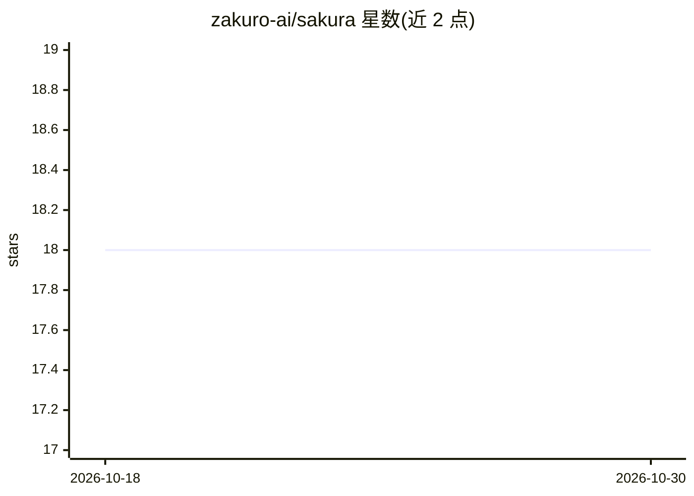

# zakuro-ai/sakura

⭐ 18 · Python · BSD-3-Clause · 推送 2026-10-28 · [GitHub](https://github.com/zakuro-ai/sakura) · 组织维护

**面向 PyTorch/Lightning/HF Trainer 的异步分布式训练加速库**

架设在 PyTorch DDP、Lightning、HuggingFace Trainer 之上的 Python 训练服务库：以可安装服务形式提供异步评估、异步 checkpoint、混合精度、torch.compile、ZeRO-1 优化器分片等能力；异步任务经 Rust 编写的 QUIC 传输（PyO3 暴露）派发到 sakura-worker 子进程，实现与训练循环的 GIL 隔离。提供 Lightning/HF/DDP 三种适配器与五种执行模式（线程/进程/本机子进程/远程/Zakuro 基础设施）。pip 安装，源码安装需 maturin 编译 Rust 组件；另附基准测试 CLI sakura-bench。

## 筛选速览

| 维度 | 判定 | 备注 |
|---|---|---|
| AI 角色 | `ai-ecosystem` | LLM/agent 周边工具 |
| 许可风险 | `permissive` | BSD-3-Clause |
| 部署形态 | `library` | 以包/库形式分发 |
| 模型依赖 | — | README 未给出锁定关系 |
| 硬件要求 | — | 无带数字的原话,不猜 |
| 安装摩擦 | `medium` | 含编译或系统依赖之一 |
| 成熟度 | `idea` | |

## 能力要点

- 异步评估/checkpoint 派发至 QUIC 子进程，GIL 隔离（Rust 传输，PyO3 暴露）
- 7 个可安装服务：混合精度、ZeRO-1 分片、torch.compile、激活检查点等
- Lightning / HuggingFace / 原生 DDP 三种框架适配器即插即用
- 附带可复现基准 CLI sakura-bench（CPU/GPU，含 LLaMA/Mistral LoRA 工作负载）

## 适用场景

- 训练循环中将评估与 checkpoint 移出主线程以重叠耗时
- 在 Lightning 或 HF Trainer 上叠加混合精度与 ZeRO-1 分片
- 用统一遥测事件总线监控 DDP 训练过程
- 本地或远程 worker 上跑异步评估（LAN/WAN QUIC）

## 场景标签

`模型训练` · 领域:训练与推理

## 证据(README 行号)

> L18: Sakura v1.0 is a standard library that sits on top of every PyTorch frontend (`torch.distributed.DistributedDataPar
> L28: Async services dispatch work to a **`sakura-worker` subprocess over QUIC** (loopback or LAN/WAN). The transport is 

## 星数曲线

2026-10-18 18 → 2026-10-30 18（+0）

---
*卡片 v1 · prompt 1.4 · 生成 2026-10-29 · 置信度 high · 依据 README sha `c48805e9e57f` · [字段定义](../../DATASET.md)*
