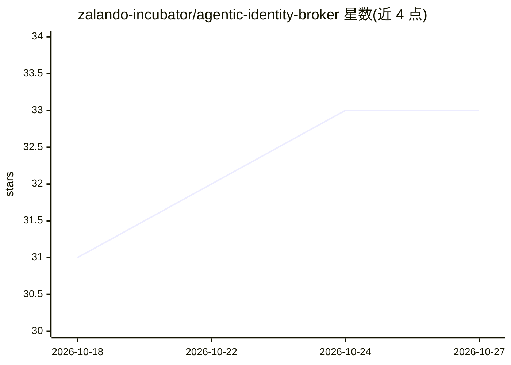

# zalando-incubator/agentic-identity-broker

⭐ 33 · Go · MIT · 推送 2026-10-26 · [GitHub](https://github.com/zalando-incubator/agentic-identity-broker) · [官网](https://agenticidentitybroker.dev) · 组织维护

**为 AI agent 提供 OAuth2 委托与同意管理的身份代理**

Zalando 孵化的身份代理服务：管理 Agentic AI 中 on-behalf-of 流程的委托链，桥接不同的 OAuth2 基础设施，提供安全 token 金库与同意管理 UI。通过 Agentgateway 等网关部署在调用路径中，将认证负担从 agent 与 MCP server 开发者处卸载。支持 agent 注册、OAuth2 scope 管理、用户同意、敏感值脱敏、命令注入防护与结构化审计日志，并支持无用户在场的委托链与集中式工具审批。

## 筛选速览

| 维度 | 判定 | 备注 |
|---|---|---|
| AI 角色 | `ai-ecosystem` | LLM/agent 周边工具 |
| 许可风险 | `permissive` | MIT |
| 部署形态 | `None` |  |
| 模型依赖 | — | README 未给出锁定关系 |
| 硬件要求 | — | 无带数字的原话,不猜 |
| 安装摩擦 | `low` | 无编译、无系统依赖或容器化 |
| 成熟度 | — | 结构信号不足 |

## 能力要点

- OAuth2 委托链与跨基础设施的 token 转换
- 内置同意管理 UI 与集中式工具审批
- 安全 token 金库与 fail-closed 架构
- 结构化 JSON 审计日志

## 适用场景

- 企业内部统一管理大量 MCP server 的 OAuth2 认证
- SaaS 为客户 MCP server 附加同意记录与审计
- 托管 agent 用单一用户 token 访问多个 MCP server

## 场景标签

 · 领域:AI 基础设施/身份安全

## 证据(README 行号)

> L27: **Agentic Identity Broker** manages delegation chains for on-behalf-of flows in Agentic AI, bridges distinct OAuth2
> L52: Frameworks like FastMCP can implement the whole OAuth2.1 ceremonies as mandated by the MCP spec but this means that

## 星数曲线

2026-10-18 31 → 2026-10-27 33（+2）

---
*卡片 v1 · prompt 1.4 · 生成 2026-10-25 · 置信度 high · 依据 README sha `b73cfb80bb62` · [字段定义](../../DATASET.md)*
