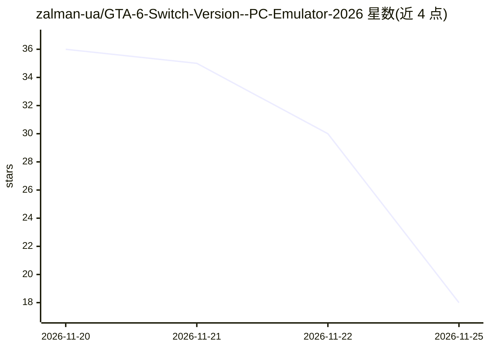

# zalman-ua/GTA-6-Switch-Version--PC-Emulator-2026

⭐ — · [GitHub]() · 个人维护

**面向 Windows 玩家的 GTA VI PC 安装准备与配置指南站点**

一个面向 Windows 10/11 用户的 GTA VI PC 版安装与配置资源仓库，内容覆盖 Windows 环境准备、显卡驱动验证、存储检查、Rockstar Games Launcher 准备、图形与 FPS 优化指引及常见安装故障排查。README 明确说明其安装包不含 GTA VI 游戏文件，仅为独立的 Windows 设置配套工具；官方 PC 版发布日期与硬件要求尚未公布，相关表格标注为未确认。仓库含 SEO 关键词段落与官方资源链接。

## 筛选速览

| 维度 | 判定 | 备注 |
|---|---|---|
| AI 角色 | `ai-knowledge` | 知识聚合/清单类 |
| 许可风险 | `permissive` | — |
| 部署形态 | `desktop` | 安装包/桌面程序 |
| 模型依赖 | — | README 未给出锁定关系 |
| 硬件要求 | — | 无带数字的原话,不猜 |
| 安装摩擦 | `low` | 无编译、无系统依赖或容器化 |
| 成熟度 | `idea` | |

## 能力要点

- Windows 兼容性准备清单（DirectX、驱动、存储检查）
- 图形设置与 FPS 优化指引（分辨率、阴影、光追、帧生成等）
- 常见安装错误与性能问题的排查分类
- 官方发布信息与硬件要求标注为未确认并将随公告更新

## 适用场景

- 在 GTA VI PC 版发布前准备和检查 Windows 环境
- 排查 PC 游戏安装错误与低 FPS/卡顿问题
- 了解 Rockstar 官方发布信息的汇总入口

## 场景标签

 · 领域:游戏/桌面工具

## 证据(README 行号)

> L5: A dedicated PC installation and configuration resource for Grand Theft Auto VI, covering Windows preparation, graphi
> L19: The installation resource focuses on:
> L49: The companion installer does not contain or install GTA VI game files.

## 星数曲线

2026-11-20 36 → 2026-11-25 18（-18）

---
*卡片 v1 · prompt 1.4 · 生成 2026-11-22 · 置信度 low · 依据 README sha `2fe487426686` · [字段定义](../../DATASET.md)*
