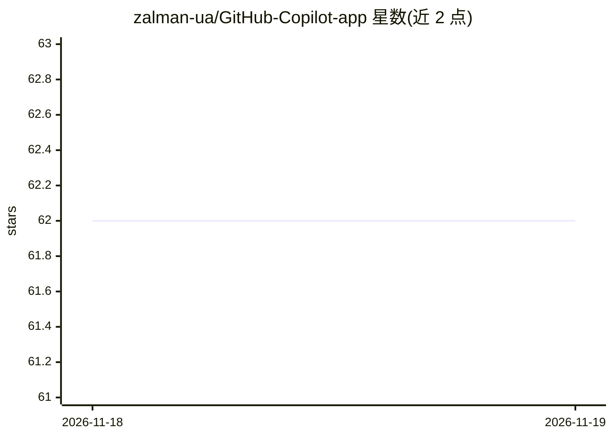

# zalman-ua/GitHub-Copilot-app

⭐ 62 · Apache-2.0 · 推送 2026-11-18 · [GitHub](https://github.com/zalman-ua/GitHub-Copilot-app) · 组织维护

**管理 GitHub Copilot agent 软件工作的桌面应用**

GitHub, Inc. 的桌面应用，作为管理软件工作的单一控制中心：查找待做工作、启动和引导 agent、审查进度并跨仓库落地变更。本地会话各自运行在隔离的 git worktree 中，云会话运行在 GitHub 托管的隔离环境；Canvas 提供可检视的工作面板；My Work 聚合会话、issue 与 PR；Automations 支持定时/后台任务，Agent Merge 辅助 PR 走完审查与合并流程。需 Git 与任意 Copilot 订阅（含免费版），也可 BYOK 自带模型提供方。通过 Releases 页面下载各平台构建；仓库还用于报告问题与讨论。

## 筛选速览

| 维度 | 判定 | 备注 |
|---|---|---|
| AI 角色 | `ai-ecosystem` | LLM/agent 周边工具 |
| 许可风险 | `permissive` | Apache-2.0 |
| 部署形态 | `desktop` | 安装包/桌面程序 |
| 模型依赖 | — | README 未给出锁定关系 |
| 硬件要求 | — | 无带数字的原话,不猜 |
| 安装摩擦 | `low` | 无编译、无系统依赖或容器化 |
| 成熟度 | — | 结构信号不足 |

## 能力要点

- 本地会话各自隔离在独立 git worktree，云会话在 GitHub 托管环境运行
- Canvas 将 agent 的计划、终端、diff 与工作流状态呈现为可编辑面板
- Automations 将可重复的提示与工作流转为定时/后台任务
- 支持 BYOK 自带模型提供方，无 Copilot 订阅也可使用

## 适用场景

- 跨多个仓库并行驱动 agent 处理 bug、issue 与代码审查
- 在一个界面里统一查看会话、issue、PR 并决定下一步工作
- 让 agent 在隔离环境中继续执行并从任意设备接手

## 场景标签

`工作流自动化` `代码审查` `编码 Agent` · 领域:效率与自动化

## 证据(README 行号)

> L3: The GitHub Copilot app is an agent-native desktop experience for finding, running, steering, and landing software wo
> L13: The GitHub Copilot app is an agent-native desktop experience for managing software work from idea to pull request. 
> L26: - A GitHub Copilot plan — any plan works, including Copilot Free and GitHub Copilot Student. No Copilot plan? You c

## 星数曲线

2026-11-18 62 → 2026-11-19 62（+0）

---
*卡片 v1 · prompt 1.4 · 生成 2026-11-18 · 置信度 high · 依据 README sha `ef82cf6db0cd` · [字段定义](../../DATASET.md)*
