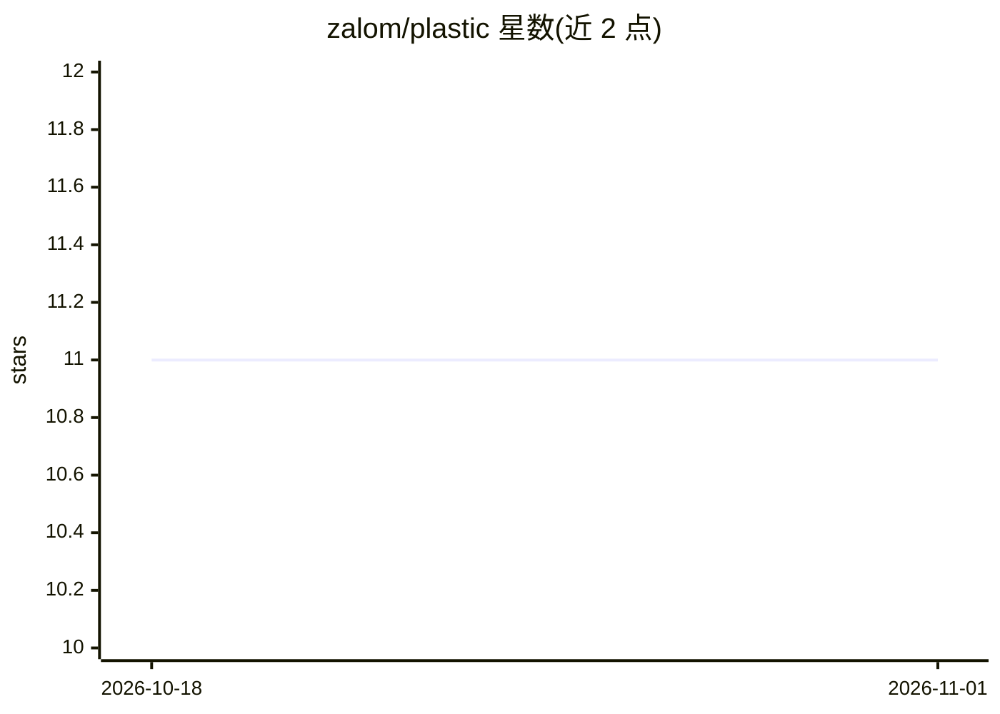

# zalom/plastic

⭐ 11 · Ruby · MIT · 推送 2026-10-16 · [GitHub](https://github.com/zalom/plastic) · [官网](https://github.com/zalom/plastic) · 个人维护

**面向 AI agent 的意图驱动工作流记录与编排命令行系统**

用 Ruby 实现的 CLI 工具（npm 分发），把一个意图（intent）沿 What/Why/How/Exec 四阶段落成纯 Markdown + Git 的持久记录：创建意图目录、追加决策、以清单或依赖图管理计划、为 agent 团队装配交付锁与角色简报、搜索历史决策。提供 40 余个命令、--json 输出与 agent hooks，可安装进 Claude Code 与 Codex CLI。自身不做任何模型调用，数据不出本机。

## 筛选速览

| 维度 | 判定 | 备注 |
|---|---|---|
| AI 角色 | `ai-ecosystem` | LLM/agent 周边工具 |
| 许可风险 | `permissive` | MIT |
| 部署形态 | `library` | 以包/库形式分发 |
| 模型依赖 | locked-api |  |
| 硬件要求 | — | 无带数字的原话,不猜 |
| 安装摩擦 | `low` | 无编译、无系统依赖或容器化 |
| 成熟度 | — | 结构信号不足 |

## 能力要点

- 意图四阶段（What/Why/How/Exec）映射为磁盘上的 Markdown 文件结构
- 清单或依赖图两种计划形态，推导下一步动作（next/because 输出）
- auto teams：交付锁、角色简报、完成报告，附 7 个内置 agent
- 纯 Markdown + Git 存储，append-only 台账，不发起模型调用

## 适用场景

- 把模糊想法逐步落成有据可查的工程交付记录
- 让 Claude Code / Codex CLI 等 coding agent 按结构化意图推进工作
- 跨会话恢复项目状态并检索历史决策

## 场景标签

`工作流自动化` `Agent 框架` · 领域:Agent 开发

## 证据(README 行号)

> L19: Plastic is an intent-based system for AI-assisted work. You do not always start with a task.
> L284: The installer registers hooks in your agent. At session start a hook runs the fast doctor,

## 星数曲线

2026-10-18 11 → 2026-11-01 11（+0）

---
*卡片 v1 · prompt 1.4 · 生成 2026-11-01 · 置信度 high · 依据 README sha `867a86ba6fc4` · [字段定义](../../DATASET.md)*
