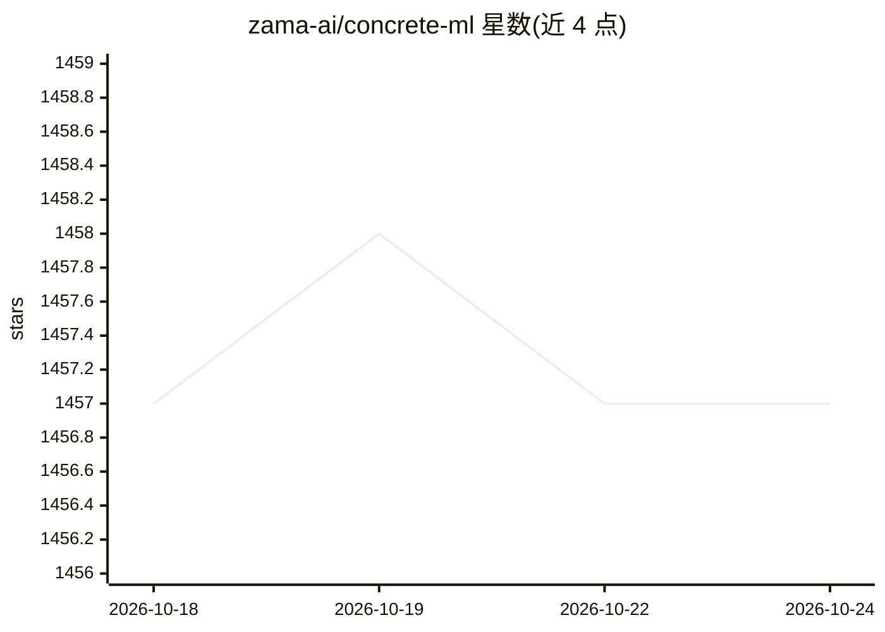

# zama-ai/concrete-ml

⭐ 1,457 · Python · NOASSERTION · 推送 2026-08-04 · [GitHub](https://github.com/zama-ai/concrete-ml) · 组织维护

**数据科学家用的全同态加密隐私保护机器学习框架**

Zama 维护的隐私保护机器学习（PPML）Python 库，基于 Concrete 构建。提供与 scikit-learn/XGBoost 接口相近的内置 FHE 模型（如 LogisticRegression），并支持将通过 PyTorch 或 keras/tensorflow 训练、经 ONNX 导入的量化感知模型转换为 FHE 可执行版本，在加密数据上执行推理或训练。限制：BSD-3-Clause-Clear 许可下免费使用仅限开发/研究/原型用途，商业使用需购买 Zama 专利许可；Windows 仅 Docker 安装；支持 Python 3.8-3.12。

## 筛选速览

| 维度 | 判定 | 备注 |
|---|---|---|
| AI 角色 | `ai-native` | 本体是模型或模型工具 |
| 许可风险 | `none` | NOASSERTION |
| 部署形态 | `self-host` | docker 或自建部署 |
| 模型依赖 | — | README 未给出锁定关系 |
| 硬件要求 | — | 无带数字的原话,不猜 |
| 安装摩擦 | `low` | 无编译、无系统依赖或容器化 |
| 成熟度 | — | 结构信号不足 |

## 能力要点

- 内置模型的 API 与 scikit-learn/XGBoost 对应模型相近
- 支持 PyTorch / keras-tensorflow 模型经 ONNX 导入转换为 FHE
- 可在加密数据上执行推理与训练
- Hugging Face 上提供信用卡审批、情感分析、健康诊断等加密演示

## 适用场景

- 在医疗、金融等敏感数据上做加密的机器学习分析
- 将已有 scikit-learn 或 PyTorch 模型转为同态加密版本以保护数据隐私
- 在不可信云环境中部署预测服务而不暴露明文数据

## 场景标签

 · 领域:隐私计算/机器学习

## 证据(README 行号)

> L13: **Concrete ML** is a Privacy-Preserving Machine Learning (PPML) open-source set of tools built on top of Concrete b
> L15: It simplifies the use of fully homomorphic encryption (FHE) for data scientists so that they can automatically turn

## 星数曲线

2026-10-18 1,457 → 2026-10-24 1,457（+0）

---
*卡片 v1 · prompt 1.4 · 生成 2026-10-21 · 置信度 high · 依据 README sha `c6f40c46ed0e` · [字段定义](../../DATASET.md)*
