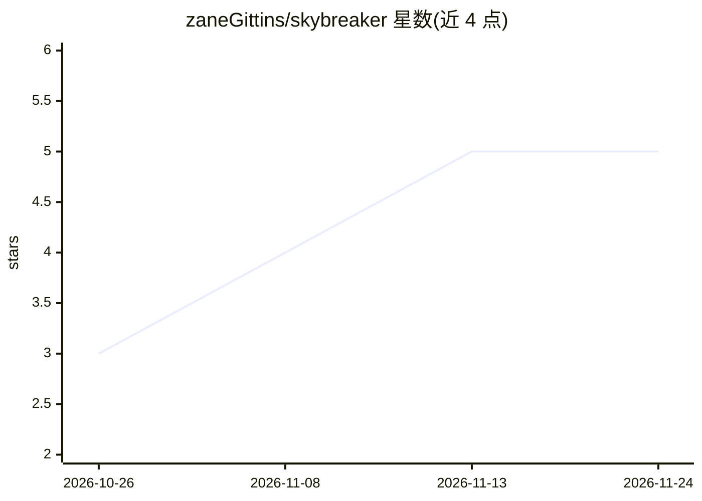

# zaneGittins/skybreaker

⭐ 5 · Go · AGPL-3.0 · 推送 2026-11-18 · [GitHub](https://github.com/zaneGittins/skybreaker) · 个人维护

**在自有服务器沙箱中运行编程 agent 的凭证隔离代理**

在用户自控的 Linux 服务器上，以 gVisor 沙箱按项目运行 Claude Code、Codex 和 pi 编程 agent。内置 broker 持有凭证，对 agent 发出的每个请求按策略检查，放行、扣留待用户批准或拒绝，默认拒绝并全程审计，附带 kill switch。用户经 Tailscale 从网页应用、手机、终端或 VS Code 驱动 agent；每个会话独立分支工作，可审查 diff 后让 agent 开 pull request。需 Debian/Ubuntu 服务器、Tailscale tailnet 与 GitHub 账号，通过安装脚本部署。

## 筛选速览

| 维度 | 判定 | 备注 |
|---|---|---|
| AI 角色 | `ai-ecosystem` | LLM/agent 周边工具 |
| 许可风险 | `viral` | AGPL-3.0 |
| 部署形态 | `None` |  |
| 模型依赖 | — | README 未给出锁定关系 |
| 硬件要求 | — | 无带数字的原话,不猜 |
| 安装摩擦 | `low` | 无编译、无系统依赖或容器化 |
| 成熟度 | `idea` | |

## 能力要点

- broker 凭证管理：仅在请求出口按绑定主机注入 token，agent 不可见凭证
- 默认拒绝的请求策略检查：放行/待批准/拒绝三态，全程审计带 kill switch
- gVisor 沙箱按项目隔离运行 agent，网页/手机/终端/VS Code 多端驱动
- 每个会话独立分支，agent 通过 MCP 工具接手与交还任务

## 适用场景

- 让编程 agent 使用我的订阅凭证而凭证不暴露给 agent
- 在手机上审批 agent 的敏感请求并接收推送通知
- 审查 agent 的 diff 后由它开 PR 合入代码

## 场景标签

`编码 Agent` · 领域:编码与开发

## 证据(README 行号)

> L15: Skybreaker runs Claude Code, Codex and pi in a gVisor sandbox per project on a Linux server you control. Every requ
> L33:  Your phone, browser, terminal or VS Code reaches the app over Tailscale. The app drives agents in a gVisor sandbox

## 星数曲线

2026-10-26 3 → 2026-11-24 5（+2）

---
*卡片 v1 · prompt 1.4 · 生成 2026-11-20 · 置信度 high · 依据 README sha `e1ba7147195b` · [字段定义](../../DATASET.md)*
