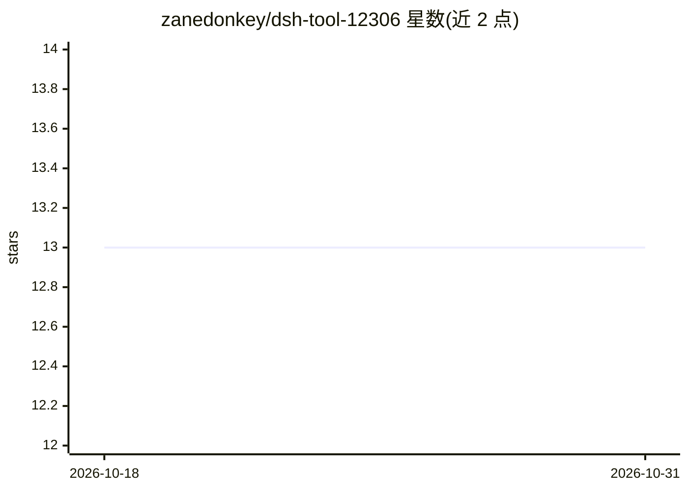

# zanedonkey/dsh-tool-12306

⭐ 13 · TypeScript · MIT · 推送 2026-10-14 · [GitHub](https://github.com/zanedonkey/dsh-tool-12306) · [官网](https://www.npmjs.com/package/dsh-tool-12306) · 个人维护 · 中文 README

**DeepSeek Harness 的 12306 车票查询原生插件**

面向 DeepSeek Harness（桌面端与 CLI）的 TypeScript 原生插件，注册 4 个工具供 Harness 中的模型以自然语言调用，实现直达车次/时刻/余票查询、两程中转与席别组合排序、经停站与沿途区间查询。查询实现基于 Joooook/12306-mcp（保留 MIT 声明）优化，无需额外启动 MCP Server。仅提供查询，不涉及登录、购票、抢票或验证码绕过。需 Node.js 22.19+/24+，已验证 Harness 0.2.0-rc.2 / 0.2.1-alpha.1。

## 筛选速览

| 维度 | 判定 | 备注 |
|---|---|---|
| AI 角色 | `ai-ecosystem` | LLM/agent 周边工具 |
| 许可风险 | `permissive` | MIT |
| 部署形态 | `None` |  |
| 模型依赖 | locked-api |  |
| 硬件要求 | — | 无带数字的原话,不猜 |
| 安装摩擦 | `low` | 无编译、无系统依赖或容器化 |
| 成熟度 | `idea` | |

## 能力要点

- 注册 4 个查询工具：直达余票、两程中转、经停区间、运行诊断
- 无需启动 MCP Server 的原生插件，支持 compact/full 两种输出模式
- 支持跨午夜时间窗口、同站/跨站换乘与最低已知票价排序
- 默认测试使用 mock/fixture，不请求真实 12306

## 适用场景

- 在 Harness 中用自然语言查询火车票余票与中转方案
- 为出行规划 agent 提供车次与票价数据来源
- 按席别、时间、车次类型筛选列车方案

## 场景标签

 · 领域:出行/交通查询工具

## 证据(README 行号)

> L5: DeepSeek Harness 原生 12306 查询插件，支持车次、余票、中转和经停站查询。基于 Joooook/12306-mcp 的查询实现优化，不需要额外启动 MCP Server。感谢大佬开源！
> L46: 安装后会自动注册以下工具，无需填写 MCP 配置：

## 星数曲线

2026-10-18 13 → 2026-10-31 13（+0）

---
*卡片 v1 · prompt 1.4 · 生成 2026-10-31 · 置信度 high · 依据 README sha `0eba58eff86a` · [字段定义](../../DATASET.md)*
