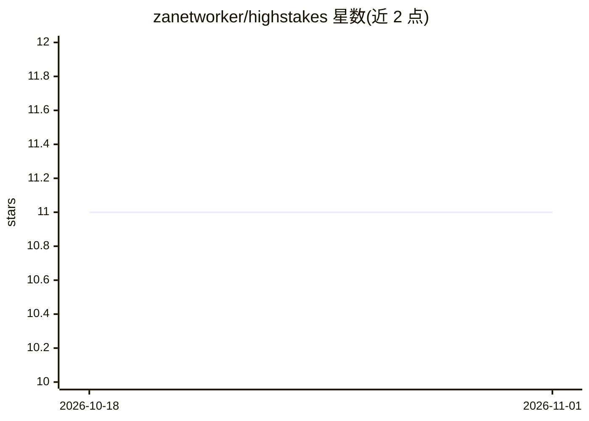

# zanetworker/highstakes

⭐ 11 · Go · MIT · 推送 2026-07-21 · [GitHub](https://github.com/zanetworker/highstakes) · [官网](https://zanetworker.github.io/highstakes/) · 个人维护

**按爆炸半径为代码库打分的热力图工具，指示人工评审重点**

Go 编写的 CLI 工具，面向需要在 AI 大量生成代码背景下分配评审精力的开发者：对仓库每个文件做静态分析（复杂度、依赖中心性）、Git 分析（变更频率、贡献者）与 LLM 评估（若此文件有 bug 会破坏什么），按四维度（安全/数据/可用性/用户）合成 0-100 热度分并映射到评审层级（CRITICAL 到 LOW），输出终端 TUI、HTML 仪表盘与 JSON；支持 PR 风险检查、GitHub Action 分流与 CI 门禁，按内容哈希缓存评估结果，也可 --no-llm 仅跑静态分析。需 OpenRouter API key（可选）与 Go 1.25+、Git。

## 筛选速览

| 维度 | 判定 | 备注 |
|---|---|---|
| AI 角色 | `ai-native` | 本体是模型或模型工具 |
| 许可风险 | `permissive` | MIT |
| 部署形态 | `library` | 以包/库形式分发 |
| 模型依赖 | locked-api |  |
| 硬件要求 | — | 无带数字的原话,不猜 |
| 安装摩擦 | `low` | 无编译、无系统依赖或容器化 |
| 成熟度 | — | 结构信号不足 |

## 能力要点

- LLM 爆炸半径（40%）与静态信号合成 0-100 热度分
- 四级评审分层（CRITICAL/LOW）映射评审要求
- TUI、HTML 仪表盘、--json 机器可读输出
- PR 风险检查、GitHub Action 与分支保护门禁集成
- agent-context 命令输出 CLI 全貌供 AI agent 发现调用

## 适用场景

- 在 AI 生成大量代码时确定哪些文件必须人工评审
- 在 CI 中对触碰高风险文件的 PR 阻断合并
- 以仪表盘或 TUI 浏览整个仓库的风险分布
- 让 AI agent 通过 agent-context 程序化调用评审 CLI

## 场景标签

`代码审查` · 领域:编码与开发

## 证据(README 行号)

> L9:  LLM-assisted blast radius analysis for every file in your repo.
> L77: 3. **LLM assessment** sends each file to an LLM: *"if this code has a bug, what breaks?"*

## 星数曲线

2026-10-18 11 → 2026-11-01 11（+0）

---
*卡片 v1 · prompt 1.4 · 生成 2026-11-01 · 置信度 high · 依据 README sha `f4670781b5b4` · [字段定义](../../DATASET.md)*
