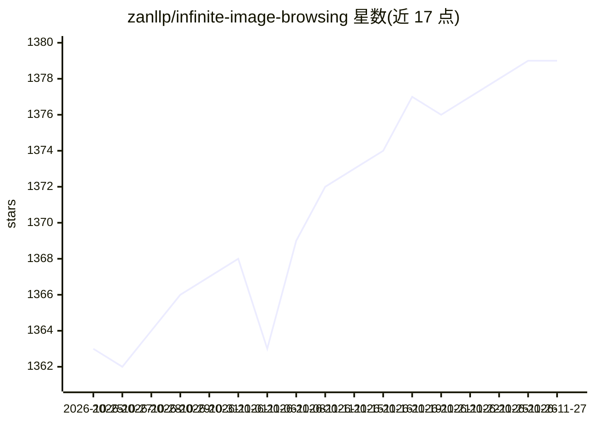

# zanllp/infinite-image-browsing

⭐ 1,379 · Python · MIT · 推送 2026-11-26 · [GitHub](https://github.com/zanllp/infinite-image-browsing) · 个人维护 · 中文 README

**面向 AI 生成图的本地管理与语义搜索工具**

IIB 是一个图片/视频管理应用，支持以 SD-webui 扩展、独立 Python 程序、桌面安装包或嵌入库四种方式运行。读取 Stable Diffusion web UI、ComfyUI、Fooocus、NovelAI、StableSwarmUI 等工具生成的元数据，提供标签/模糊/高级搜索、缩略图缓存、全屏预览、文件操作、批量下载与贡献热力图统计。Smart Organize 功能基于 embeddings 对图像做语义聚类并生成文件夹名，需配置 OPENAI_BASE_URL/OPENAI_API_KEY 及 numpy、hnswlib，且操作前可预览确认。

## 筛选速览

| 维度 | 判定 | 备注 |
|---|---|---|
| AI 角色 | `ai-enhanced` | 去掉 AI 部分产品仍成立 |
| 许可风险 | `permissive` | MIT |
| 部署形态 | `desktop` | 安装包/桌面程序 |
| 模型依赖 | — | README 未给出锁定关系 |
| 硬件要求 | — | 无带数字的原话,不猜 |
| 安装摩擦 | `low` | 无编译、无系统依赖或容器化 |
| 成熟度 | — | 结构信号不足 |

## 能力要点

- 读取 SD-webui/ComfyUI/Fooocus/NovelAI/StableSwarmUI/Invoke.AI 等工具的生成元数据
- Smart Organize 基于语义聚类自动整理并生成文件夹名，操作前可预览
- 支持标签搜索、自动翻译、模糊搜索与自定义搜索路径
- 提供 SD-webui 扩展、独立运行、桌面安装包与 iframe 库四种使用方式

## 适用场景

- 管理本地 AI 绘图工具生成的大量图片并按元数据检索
- 按语义自动归类整理生成图片文件夹
- 在远程服务器上浏览和预览图片/视频
- 作为嵌入组件为其他应用提供文件浏览能力

## 场景标签

`语义搜索` · 领域:知识与检索

## 证据(README 行号)

> L50: - You can install it as an extension on SD-webui.
> L89: AI-powered automatic file organization
> L172: IIB can be used with AI agents like Claude Code, Cursor, and OpenClaw. See AI Agents Documentation for details.

## 星数曲线

2026-10-25 1,363 → 2026-11-27 1,379（+16）

---
*卡片 v1 · prompt 1.4 · 生成 2026-11-23 · 置信度 mid · 依据 README sha `18bddf30ea2e` · [字段定义](../../DATASET.md)*
