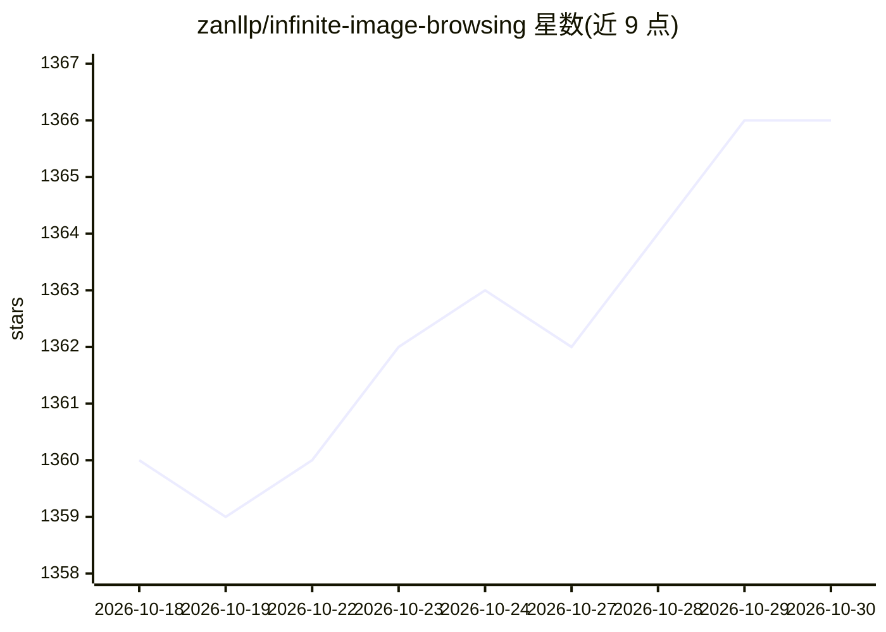

# zanllp/infinite-image-browsing

⭐ 1,366 · Python · MIT · 推送 2026-10-29 · [GitHub](https://github.com/zanllp/infinite-image-browsing) · 个人维护 · 中文 README

**面向 AI 绘图用户的图片/视频管理与语义搜索应用**

图片/视频浏览管理应用，可读取 SD-webui、ComfyUI、Fooocus、NovelAI、StableSwarmUI、Invoke.AI 等软件生成的图片元数据，将 prompt、模型、Lora 转为标签做精确/模糊/类 Google 高级搜索。支持 SD-webui 扩展、独立 Python 运行、桌面版与 iframe 嵌入四种形态。AI 部分为基于 embedding 的语义聚类整理（Smart Organize）与自然语言检索，需配置 OPENAI_BASE_URL/OPENAI_API_KEY 与 numpy、hnswlib 依赖。

## 筛选速览

| 维度 | 判定 | 备注 |
|---|---|---|
| AI 角色 | `ai-enhanced` | 去掉 AI 部分产品仍成立 |
| 许可风险 | `permissive` | MIT |
| 部署形态 | `self-host` | docker 或自建部署 |
| 模型依赖 | — | README 未给出锁定关系 |
| 硬件要求 | — | 无带数字的原话,不猜 |
| 安装摩擦 | `low` | 无编译、无系统依赖或容器化 |
| 成熟度 | `idea` | |

## 能力要点

- 读取多种 AI 绘图软件的元数据并转为可搜索标签
- 基于 embedding 的语义聚类整理与 AI 生成文件夹名
- SD-webui 扩展/独立 Python/桌面版/iframe 库四种使用形态
- 文件树浏览、多选操作、批量下载、Walk 模式（27,000+ 文件测试）

## 适用场景

- 管理和检索 SD-webui/ComfyUI 等生成的大量图片
- 按 prompt 语义自动聚类整理图片到文件夹
- 用自然语言检索自己的图片库
- 通过 iframe 嵌入自己的应用作为文件浏览器

## 场景标签

`语义搜索` `图像视频处理` · 领域:知识与检索

## 证据(README 行号)

> L12: |Stable Diffusion web UI|Supported|Built-in|
> L91: - **Semantic Clustering**: Automatically groups similar images based on prompt semantics using AI embeddings
> L97: > **Requirements**: Same as Topic Search - requires `OPENAI_BASE_URL`, `OPENAI_API_KEY`, and Python dependencies `n

## 星数曲线

2026-10-18 1,360 → 2026-10-30 1,366（+6）

---
*卡片 v1 · prompt 1.4 · 生成 2026-10-21 · 置信度 mid · 依据 README sha `26bc649488f2` · [字段定义](../../DATASET.md)*
