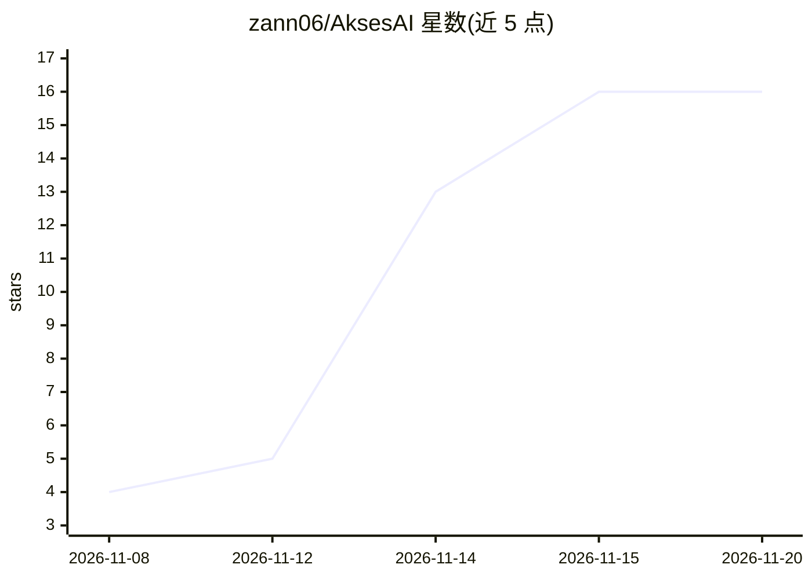

# zann06/AksesAI

⭐ 16 · TypeScript · MIT · 推送 2026-11-15 · [GitHub](https://github.com/zann06/AksesAI) · [官网](https://aksesai-id.vercel.app) · 个人维护

**印尼社区维护的免费/低价 AI 资源目录（免费 API、token 价格等）**

社区贡献、人工验证的 AI 资源信息目录网站：收录免费 API/token、free tier、按 token 计价、开放权重模型、免费工具与托管信息，每个条目须有至少一个官方来源并经人工审核后发布，且每 90 天定期复审。平台按角色分工（贡献者/审核者/ moderator/管理员），声明非任何 AI 提供商附属，应用内无 AI/chatbot 功能。技术栈为 Next.js 16 + TypeScript + Supabase（PostgreSQL、RLS、GitHub OAuth），通过 git clone 源码与 Supabase 本地栈运行。

## 筛选速览

| 维度 | 判定 | 备注 |
|---|---|---|
| AI 角色 | `ai-knowledge` | 知识聚合/清单类 |
| 许可风险 | `permissive` | MIT |
| 部署形态 | `library` | 以包/库形式分发 |
| 模型依赖 | — | README 未给出锁定关系 |
| 硬件要求 | — | 无带数字的原话,不猜 |
| 安装摩擦 | `low` | 无编译、无系统依赖或容器化 |
| 成熟度 | — | 结构信号不足 |

## 能力要点

- 条目须附至少一个官方来源并经人工验证，90 天定期复审
- 全文检索（ts_rank）、分类/状态过滤与价格变更历史
- 角色分工与审核流程：30 分钟认领队列、不可审核自己提交、不可变审计日志
- 数据库 schema 与迁移公开，全表启用 RLS

## 适用场景

- 查找免费或低价的 AI API、free tier 与开放权重模型信息
- 比较各 provider 的按 token 计价
- 作为社区贡献者提交并审核 AI 资源条目

## 场景标签

`精选清单` · 领域:学习与行业

## 证据(README 行号)

> L5: **Direktori info gratis & murah seputar AI, dari komunitas, dengan sumber yang bisa diperiksa.**
> L16: API/token gratis, free tier, harga per token, model open-weight, tool gratis, dan hosting gratis — setiap entri waj
> L104: Tanpa AI/chatbot di dalam aplikasi — tidak memerlukan API key AI apa pun.

## 星数曲线

2026-11-08 4 → 2026-11-20 16（+12）

---
*卡片 v1 · prompt 1.4 · 生成 2026-11-18 · 置信度 mid · 依据 README sha `d1dc0021b789` · [字段定义](../../DATASET.md)*
