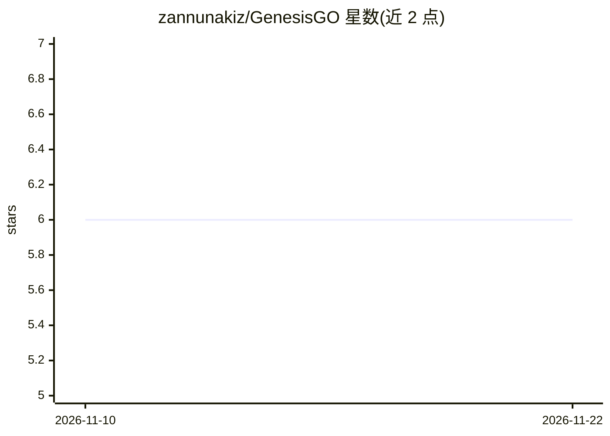

# zannunakiz/GenesisGO

⭐ 6 · Go · MIT · 推送 2026-11-04 · [GitHub](https://github.com/zannunakiz/GenesisGO) · 个人维护

**给后端开发者做事件驱动消息失败模拟与确定性判定**

本地优先的事件驱动可靠性测试平台：内置 Go 支付/库存示例消费者，通过 NATS JetStream 注入受控故障配方（重复投递、重试、乱序、ack 超时、消费者重启、提交后崩溃），按 run_id 隔离每次运行，检查确定性业务不变量并输出 PASS/FAIL 判定。判定来自记录状态而非投递结果本身；可选本地 Ollama 仅做证据摘要建议，不参与判定。V1 仅支持内置示例消费者，不触碰生产基础设施。

## 筛选速览

| 维度 | 判定 | 备注 |
|---|---|---|
| AI 角色 | `ai-enhanced` | 去掉 AI 部分产品仍成立 |
| 许可风险 | `permissive` | MIT |
| 部署形态 | `self-host` | docker 或自建部署 |
| 模型依赖 | local-ok | 支持本地模型 |
| 硬件要求 | — | 无带数字的原话,不猜 |
| 安装摩擦 | `low` | 无编译、无系统依赖或容器化 |
| 成熟度 | — | 结构信号不足 |

## 能力要点

- 6 种内置故障场景配方与确定性不变量判定
- run_id 隔离的证据存储与交付时间线、副作用记录
- 可选本地 Ollama 仅做咨询性诊断，不决定结果
- 可选观测栈：OpenTelemetry/Prometheus/Tempo/Loki/Grafana

## 适用场景

- 在隔离环境中复现消息重复投递、乱序等故障
- 验证消费者幂等键去重与状态恢复逻辑
- 本地 CI 中获得可复现的 PASS/FAIL 可靠性报告
- 用 REST/SSE 导出 JSON/CSV 运行证据做排查

## 场景标签

 · 领域:开发者工具/软件测试

## 证据(README 行号)

> L5:  Event-driven reliability testing and controlled failure simulation for backend developers.
> L32:  No production infrastructure is touched. Every run is isolated by <code>run_id</code>; AI diagnosis is optional an
> L52: |5|**Get AI Diagnosis (Optional)**|Use local Ollama to summarise execution evidence and suggest potential issues. A

## 星数曲线

2026-11-10 6 → 2026-11-22 6（+0）

---
*卡片 v1 · prompt 1.4 · 生成 2026-11-20 · 置信度 high · 依据 README sha `fa1bae5ff807` · [字段定义](../../DATASET.md)*
