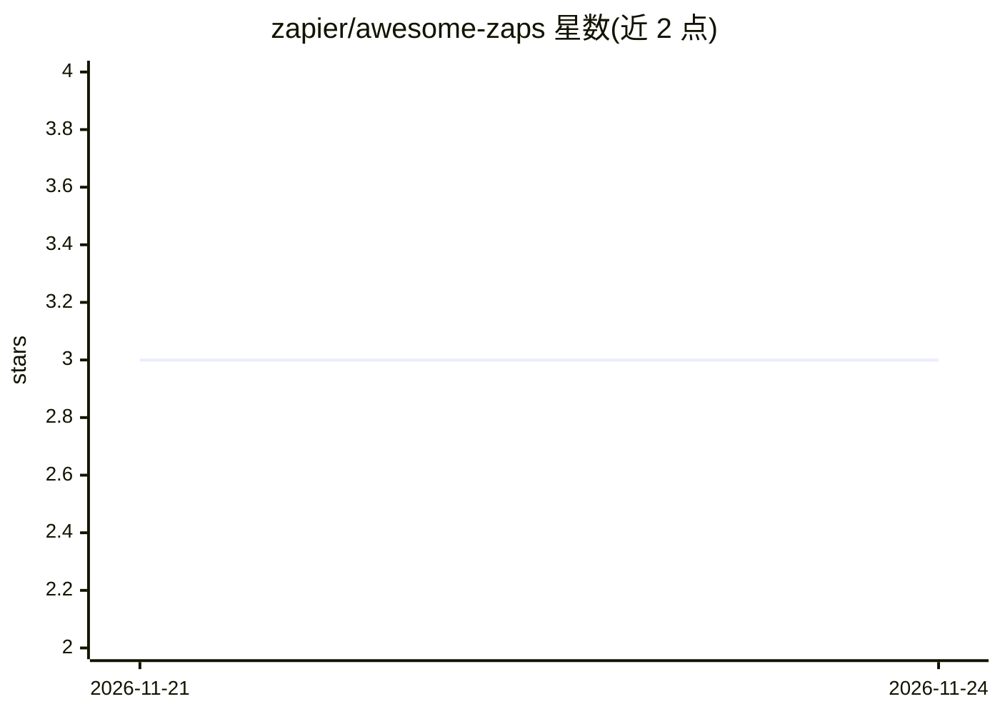

# zapier/awesome-zaps

⭐ 4 · TypeScript · MIT · 推送 2026-11-24 · [GitHub](https://github.com/zapier/awesome-zaps) · 组织维护

**给 AI agent 用户的一行安装式 Zap 自动化模板清单**

Zapier 维护的 Zap 模板合集：用户在 AI agent 中粘贴一行提示，agent 按 SKILL.md 询问所需配置值，通过 Zapier MCP 构建、测试并在用户的 Zapier 账户中启用该 Zap。每个 zap 为一个纯文件文件夹（README.md、SKILL.md 等），仓库另含目录测试与部署/状态检查脚本，以及从 zapier.com 页面或运行中的 Zap 生成模板的 skill。仅接受 Zapier 官方维护，不接受外部贡献；运行 Zap 需遵守 Zapier 服务条款。

## 筛选速览

| 维度 | 判定 | 备注 |
|---|---|---|
| AI 角色 | `ai-knowledge` | 知识聚合/清单类 |
| 许可风险 | `permissive` | MIT |
| 部署形态 | `library` | 以包/库形式分发 |
| 模型依赖 | — | README 未给出锁定关系 |
| 硬件要求 | — | 无带数字的原话,不猜 |
| 安装摩擦 | `low` | 无编译、无系统依赖或容器化 |
| 成熟度 | — | 结构信号不足 |

## 能力要点

- 一行提示即可让 agent 构建、测试并启用 Zap
- 通过 Zapier MCP 完成 Zap 的构建与接入引导
- 每个 zap 为纯文件文件夹（README.md/SKILL.md）
- 提供从 zapier.com 页面或运行中 Zap 生成模板的 skill

## 适用场景

- 用 agent 快速搭建一条 Zapier 自动化流程
- 把现有的 Zap 转成可复用的模板
- 批量浏览 Zapier 官方整理的自动化场景模板

## 场景标签

`工作流自动化` `精选清单` · 领域:效率与自动化

## 证据(README 行号)

> L3: Zap templates you install by pasting one line into your AI agent. Written and maintained by Zapier; the repo doesn't
> L20: ├── SKILL.md         what the agent asks, builds and tests
> L28: |`zaps/<zap>/`|One zap per folder|

## 星数曲线

2026-11-21 3 → 2026-11-24 3（+0）

---
*卡片 v1 · prompt 1.4 · 生成 2026-11-21 · 置信度 high · 依据 README sha `da9264d61876` · [字段定义](../../DATASET.md)*
