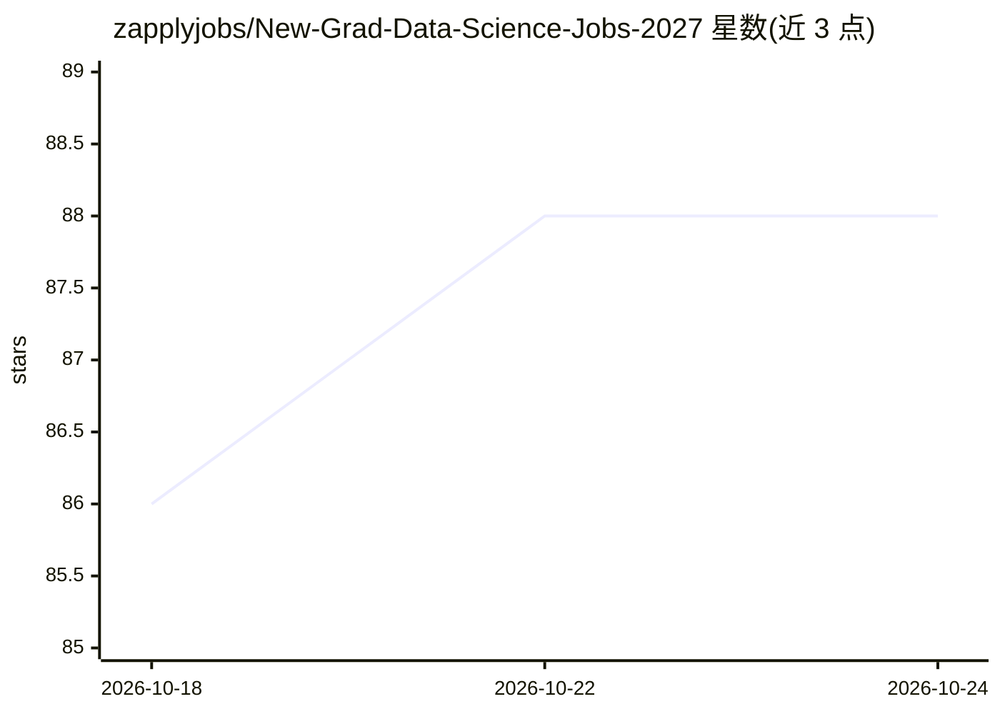

# zapplyjobs/New-Grad-Data-Science-Jobs-2027

⭐ 88 · HTML · NOASSERTION · 推送 2026-10-23 · [GitHub](https://github.com/zapplyjobs/New-Grad-Data-Science-Jobs-2027) · [官网](https://zapplyjobs.github.io/New-Grad-Data-Science-Jobs-2027/) · 组织维护

**面向应届生的 2027 届美国数据科学/ML 岗位聚合清单**

由 Zapply 维护的 2027 届入门级岗位聚合仓库：以表格形式列出数据科学家、数据分析、机器学习工程师等美国岗位，包含公司、职位、地点、发布时间与是否提供签证赞助，README 声称每 10 分钟更新一次，并标注两周内的新岗位。同时推广 Zapply 的求职网站、自动填写申请的 Chrome 扩展、多简历档案账户、申请追踪，以及 Discord/LinkedIn 社区。本体为岗位数据清单，非软件产品，无安装运行方式。

## 筛选速览

| 维度 | 判定 | 备注 |
|---|---|---|
| AI 角色 | `ai-knowledge` | 知识聚合/清单类 |
| 许可风险 | `none` | NOASSERTION |
| 部署形态 | `None` |  |
| 模型依赖 | — | README 未给出锁定关系 |
| 硬件要求 | — | 无带数字的原话,不猜 |
| 安装摩擦 | `medium` | 含编译或系统依赖之一 |
| 成熟度 | — | 结构信号不足 |

## 能力要点

- 表格列出公司/职位/地点/发布时间/签证赞助信息
- README 声称每 10 分钟更新
- 附带 Zapply 网站与 Chrome 自动填写扩展入口
- 提供 Discord 与 LinkedIn 社区链接

## 适用场景

- 查找 2027 届美国数据科学/分析/ML 入门级与实习岗位
- 按签证赞助标记筛选可投递的公司
- 通过 Zapply 扩展加速申请流程

## 场景标签

 · 领域:求职/职业信息

## 证据(README 行号)

> L5:  🚀 Data science, analytics, and ML jobs for new graduates, updated every 10 minutes.
> L41: |Company|Role|Location|Posted|Visa|**Apply**|

## 星数曲线

2026-10-18 86 → 2026-10-24 88（+2）

---
*卡片 v1 · prompt 1.4 · 生成 2026-10-23 · 置信度 low · 依据 README sha `ad8f68e9a23e` · [字段定义](../../DATASET.md)*
