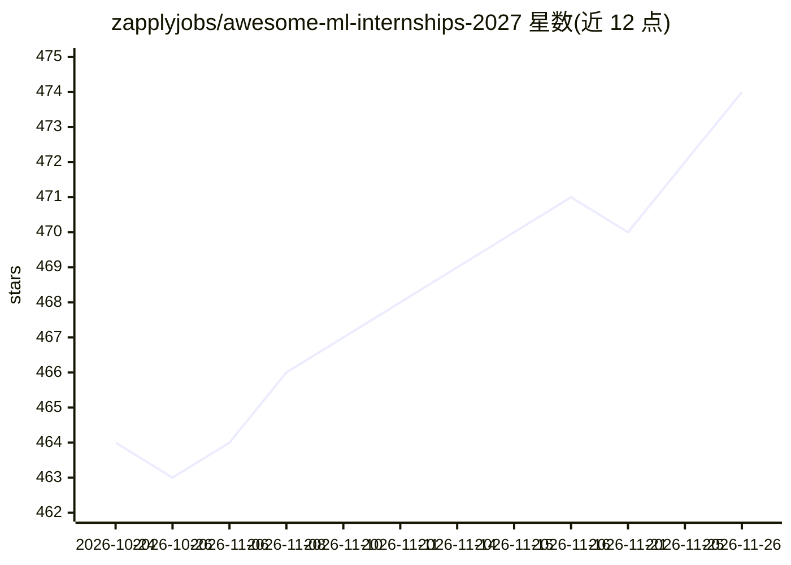

# zapplyjobs/awesome-ml-internships-2027

⭐ 474 · 推送 2026-11-25 · [GitHub](https://github.com/zapplyjobs/awesome-ml-internships-2027) · [官网](https://softwarejobs.dev/?ref=gh-awesome-ml-internships) · 组织维护

**面向学生的 AI/ML/数据科学实习岗位聚合清单，自动刷新**

一份由 Zapply job pipeline 自动刷新（声称每 10 分钟更新）的 2027 年 AI、机器学习与数据科学实习岗位清单，按职位类别（ML/AI 工程、数据科学与分析等）以表格列出公司、岗位、地点、发布时间和是否支持签证担保，并提供申请链接。清单同时推广 Zapply 网站与 Chrome 自动填表扩展、求职追踪功能及其 Discord/LinkedIn 社区。定位为求职信息聚合资源，适合寻找实习的学生与新毕业生浏览筛选。

## 筛选速览

| 维度 | 判定 | 备注 |
|---|---|---|
| AI 角色 | `ai-knowledge` | 知识聚合/清单类 |
| 许可风险 | `none` | — |
| 部署形态 | `None` |  |
| 模型依赖 | — | README 未给出锁定关系 |
| 硬件要求 | — | 无带数字的原话,不猜 |
| 安装摩擦 | `low` | 无编译、无系统依赖或容器化 |
| 成熟度 | — | 结构信号不足 |

## 能力要点

- 按类别组织的实习岗位表格，含公司、地点、发布时间、签证担保标记
- 通过 Zapply job pipeline 自动刷新，声称每 10 分钟更新
- 配套 Zapply 网站与 Chrome 自动填表扩展、申请追踪功能
- 另列两周内发布的 2027 新岗位（under 2 weeks）

## 适用场景

- 学生查找 2027 年 AI/ML 方向的实习岗位
- 按是否支持签证担保筛选美国实习机会
- 追踪两周内新发布的实习职位

## 场景标签

`精选清单` · 领域:学习与行业

## 证据(README 行号)

> L3: # AI & Machine Learning Internships 2027
> L5:  🚀 Live AI, machine learning, and data science internships for students, refreshed through the Zapply job pipeline.
> L10:  Updated every 10 minutes

## 星数曲线

2026-10-24 464 → 2026-11-26 474（+10）

---
*卡片 v1 · prompt 1.4 · 生成 2026-11-25 · 置信度 high · 依据 README sha `d5b1582c05c5` · [字段定义](../../DATASET.md)*
