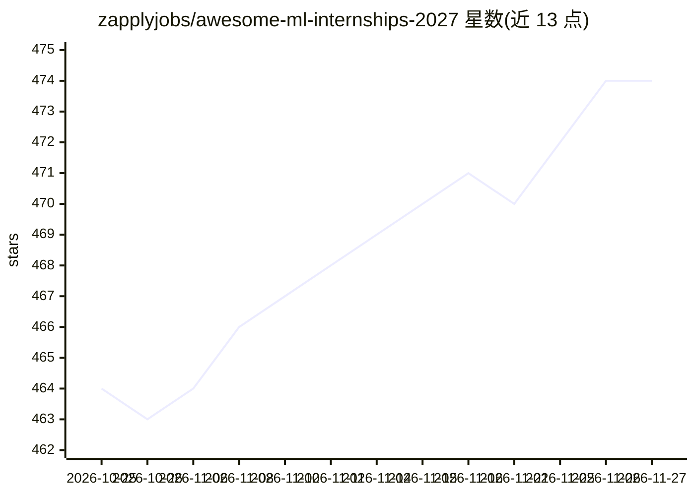

# zapplyjobs/awesome-ml-internships-2027

⭐ 474 · 推送 2026-11-26 · [GitHub](https://github.com/zapplyjobs/awesome-ml-internships-2027) · [官网](https://softwarejobs.dev/?ref=gh-awesome-ml-internships) · 组织维护

**面向学生的 AI/ML/数据科学实习岗位实时清单**

由 Zapply 任务管道自动刷新的实习岗位聚合清单，按机器学习与 AI 工程、数据科学与分析等板块组织表格条目，每条含公司、职位、地点、发布时间、签证赞助信息与申请链接，声明每 10 分钟更新一次并只保留两周内的职位。同时推广 Zapply 的求职网站、Chrome 自动填表扩展、Discord 与 LinkedIn 社区。清单以 README 表格形式提供，无安装或运行环节。

## 筛选速览

| 维度 | 判定 | 备注 |
|---|---|---|
| AI 角色 | `ai-knowledge` | 知识聚合/清单类 |
| 许可风险 | `none` | — |
| 部署形态 | `None` |  |
| 模型依赖 | — | README 未给出锁定关系 |
| 硬件要求 | — | 无带数字的原话,不猜 |
| 安装摩擦 | `low` | 无编译、无系统依赖或容器化 |
| 成熟度 | — | 结构信号不足 |

## 能力要点

- 实时更新的 2027 年 AI/ML/数据科学实习岗位表格
- 每条含公司、地点、发布时间与签证赞助标注
- 通过 Zapply job pipeline 自动刷新（声明每 10 分钟）
- 配套 Chrome 自动填表扩展与职位追踪功能

## 适用场景

- 查找 2027 年暑期 AI/机器学习实习职位
- 筛选提供签证赞助的实习机会
- 跟踪企业最新发布的实习生岗位

## 场景标签

`精选清单` · 领域:学习与行业

## 证据(README 行号)

> L3: # AI & Machine Learning Internships 2027
> L5:  🚀 Live AI, machine learning, and data science internships for students, refreshed through the Zapply job pipeline.
> L41: |Company|Role|Location|Posted|Visa|**Apply**|

## 星数曲线

2026-10-25 464 → 2026-11-27 474（+10）

---
*卡片 v1 · prompt 1.4 · 生成 2026-11-27 · 置信度 high · 依据 README sha `654a363ac95a` · [字段定义](../../DATASET.md)*
