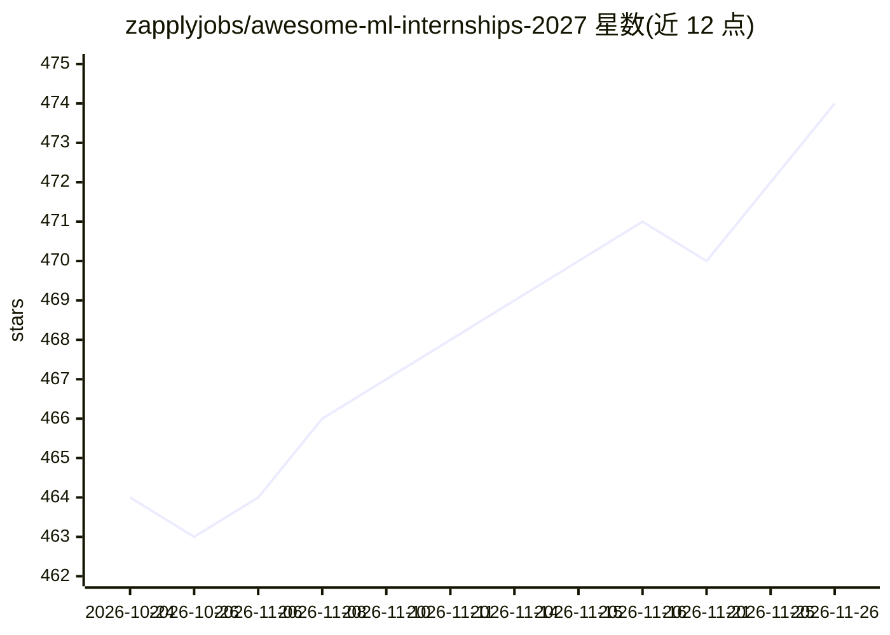

# zapplyjobs/awesome-ml-internships-2027

⭐ 474 · 推送 2026-11-25 · [GitHub](https://github.com/zapplyjobs/awesome-ml-internships-2027) · [官网](https://softwarejobs.dev/?ref=gh-awesome-ml-internships) · 组织维护

**面向学生的 AI/ML/数据科学实习岗位实时清单**

由 Zapply 职位管道自动刷新的 2027 年 AI、机器学习与数据科学实习聚合清单，每 10 分钟更新一次。条目以表格形式给出公司、职位、地点、发布时间、签证 sponsorship 状态与申请链接，覆盖机器学习工程、LLM 推理架构、计算机视觉、机器人等方向；另附 Zapply 网站与 Chrome 自动填写扩展的介绍，以及 Discord/LinkedIn 社区入口。清单仅含岗位链接，不涉及任何工具安装或运行。

## 筛选速览

| 维度 | 判定 | 备注 |
|---|---|---|
| AI 角色 | `ai-knowledge` | 知识聚合/清单类 |
| 许可风险 | `none` | — |
| 部署形态 | `None` |  |
| 模型依赖 | — | README 未给出锁定关系 |
| 硬件要求 | — | 无带数字的原话,不猜 |
| 安装摩擦 | `low` | 无编译、无系统依赖或容器化 |
| 成熟度 | — | 结构信号不足 |

## 能力要点

- 每 10 分钟刷新的实习岗位列表
- 标注签证 sponsorship（✅ Sponsor）状态
- 按 ML 工程、数据科学分析等类别分组
- 附带发布时间（如 14m、1d、1w）便于筛新鲜岗位

## 适用场景

- 查找 2027 年 AI/ML 方向的暑期实习
- 筛选提供签证 sponsorship 的岗位
- 查找两周内新发布的实习机会

## 场景标签

`精选清单` · 领域:学习与行业

## 证据(README 行号)

> L5:  🚀 Live AI, machine learning, and data science internships for students, refreshed through the Zapply job pipeline.
> L41: |Company|Role|Location|Posted|Visa|**Apply**|
> L39:  🤖 Machine Learning & AI Engineering

## 星数曲线

2026-10-24 464 → 2026-11-26 474（+10）

---
*卡片 v1 · prompt 1.4 · 生成 2026-11-26 · 置信度 high · 依据 README sha `9ed10f2fe29b` · [字段定义](../../DATASET.md)*
